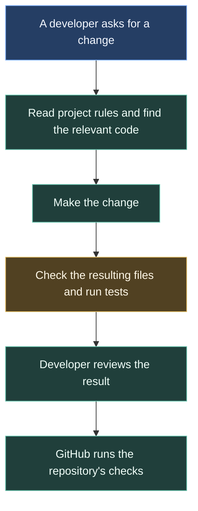
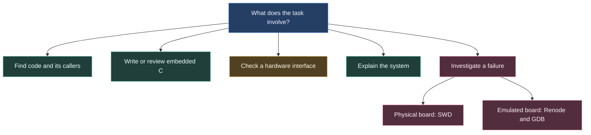
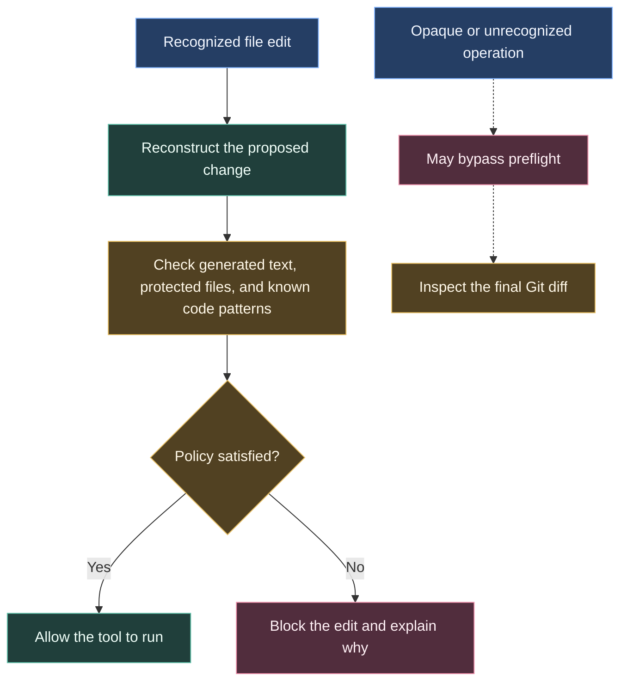
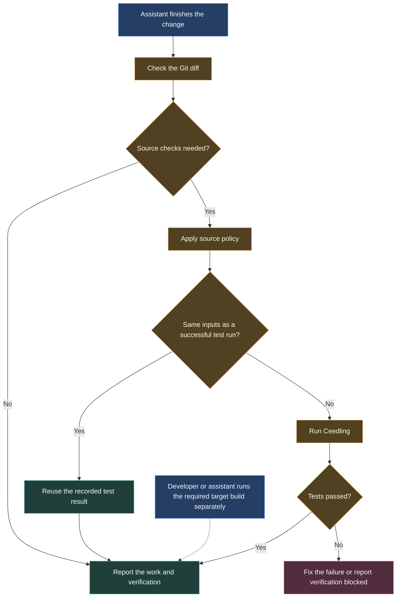
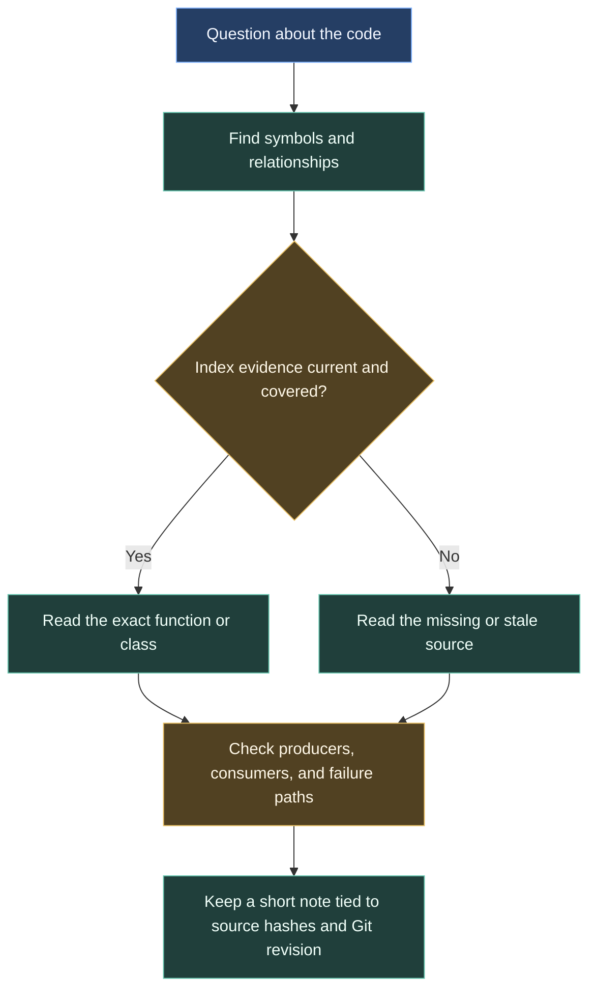
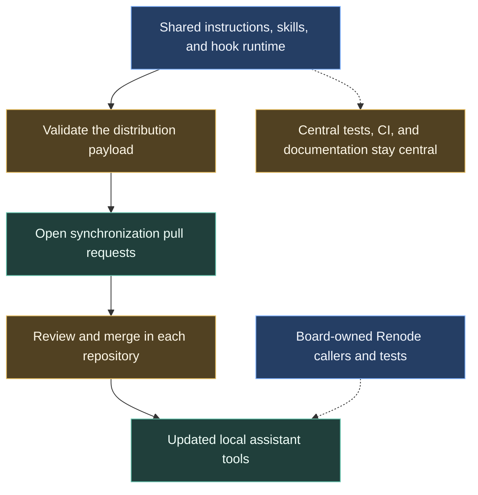

# Using coding assistants on our software

An assistant working on our firmware needs to know which files it can change, how the board is organised, and which tests to run. The agent harness brings those instructions and checks together in each repository.

We use the word **harness** for this collection of project rules, writing and debugging guides, and small programs that check the assistant’s work. It runs on the developer’s computer through the coding tool they use. It is separate from the checks GitHub runs when someone proposes a change.

The diagram below follows one change. The assistant first reads the relevant instructions, works on the task, and checks its changes before handing them back for review.



The instructions guide the work. The automated checks catch some mistakes. A developer still needs to review the result, especially when it affects hardware.

## Follow a small firmware change

Suppose we ask an assistant to change how a sensor reading is processed. Before editing, it needs to find where the reading comes from, which part of the firmware uses it, and what should happen if the sensor stops responding.

The repository’s instructions direct it to inspect those relationships first. A code-search service can help find functions and their callers without reading many unrelated files. When that service is unavailable, the assistant can read the relevant source directly and explain what it could not verify.

If the change affects a pin, a CAN message, or another hardware connection, the assistant must check the agreed specifications before changing the interface. Code alone does not establish what the hardware was intended to do.

### Give it the right guide

The repository includes short guides called **skills**. Each covers a particular kind of work, such as writing embedded C, checking hardware documentation, or debugging a board. The assistant loads the guide that applies to the task.

This keeps task-specific detail out of the general instructions. A documentation change should not require a guide to programming a microcontroller over a debug cable.

| When the task involves… | The guide covers… |
| --- | --- |
| Unfamiliar code | Finding the relevant functions, callers, and data flow |
| Embedded C | Memory use, execution limits, and coding conventions |
| Hardware interfaces | Checking specifications and resolving disagreements |
| Documentation | Explaining the system before introducing implementation detail |
| A physical board | Connecting a debugger, inspecting state, and investigating faults |
| Simulated firmware | Reproducing failures and keeping repeatable regression tests |



### Check edits before they run

Coding tools can call a small program immediately before carrying out an operation. This is called a **hook**. Our pre-tool hook inspects supported reads and edits.

For example, STM32CubeMX generates parts of the board’s startup code. It also marks blocks where we can keep our own changes. If an assistant changes generated text outside those blocks, a later CubeMX update could erase the change. The harness checks that supported edits preserve the generated text and the existing block markers.

It also checks for some other common mistakes: adding recognised dynamic-memory calls, putting recognised hardware-access calls in application code, or changing protected system files without an approved exception.

These checks recognise specific tools and code patterns. They cannot understand every script or prove that an edit is correct. Unsupported operations can get past the pre-tool check, which is why we also inspect the final files.



### Check the result before finishing

When the assistant finishes, another hook compares the files with Git’s recorded version. This catches relevant source changes even if they were made through a different editing route.

For changed source or protected system files, the stop check also runs the Ceedling unit tests, or reuses a successful result when the verification inputs are unchanged. Ceedling is the test runner we use to check C code on the development computer. If configuration or dependencies are missing, verification fails and the assistant must report the problem.

The assistant must also run the board’s required firmware build. That produces code for the microcontroller; it is a separate check from host unit tests and is not run automatically by the stop hook.

A failed stop check asks for a correction or a clear report that verification is blocked. Repeated failures are reported without forcing an endless repair loop. The fact that an assistant has ended its turn is not a test result.



## Why we keep reads small

An assistant has a limited amount of working context. Filling it with unrelated files makes it harder to keep track of the task. We therefore ask it to find the relevant symbols first and read only the source needed to understand them.

Small, cohesive files can be read whole. For files longer than 200 lines, the supported file-read checks require a function extract or a window of at most 100 lines.

The code-search service also reports which files it indexed. The assistant must check that information before relying on a search result, and read the source when indexing is incomplete or stale. No search result is a guarantee that every relationship has been found.

For longer investigations, the assistant can save a short local note about what it learned. These notes record the source files and Git version they depend on. If those inputs change, the note must be checked again before reuse.



## What we still need to check ourselves

The harness can identify certain file and code-pattern violations. It cannot confirm a physical pinout, measure interrupt timing, or decide whether a fault response is safe for the car. Those questions need the relevant specifications, engineering review, and tests.

The same distinction applies to setup. Having hook configuration files in a repository does not mean a particular coding tool has enabled them. We check activation in that tool and test its connection to the code-search and documentation services.

The repository currently provides adapters for Antigravity, Claude Code, Codex, and Cursor. Actual support depends on the installed client accepting and running its configuration.

## Getting it running

The included doctor checks the expected configuration and installed tools. After running it, check that the hooks and search services are active in the coding tool itself.

Run this command from the repository root:

```sh
python .agents/hooks/doctor.py
```

Python 3.11 or later and Git are needed for the harness checks. The search services also need Node.js/npm. Firmware tests and builds need the board repository's dependencies. The [setup reference](/architecture/agentic-harness-reference#setup-and-activation) lists the client configuration paths.

## Keeping repositories in step

We maintain the shared rules, skills, and checking programs in the central `.github` repository. A synchronization workflow proposes updates to the configured product repositories through pull requests. Someone must review and merge those changes before a board repository receives them.

We also test the harness itself on Windows and Linux. These tests check the checking programs and their client message formats; they do not replace board tests.

The [CI/CD overview](/architecture/github) explains how this distribution fits alongside firmware builds, tests, and releases.



## Further reading

Expand **Agentic Harness** in the sidebar for [setup and implementation details](/architecture/agentic-harness-reference) and the [earlier benchmark results](/architecture/agentic-harness-benchmarks). The benchmark page restores the original token-allocation pie charts and identifies their historical source.
