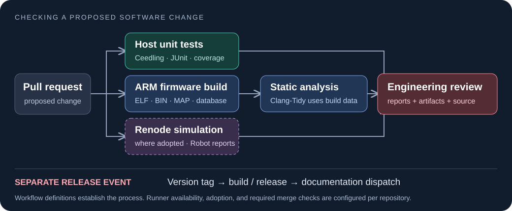
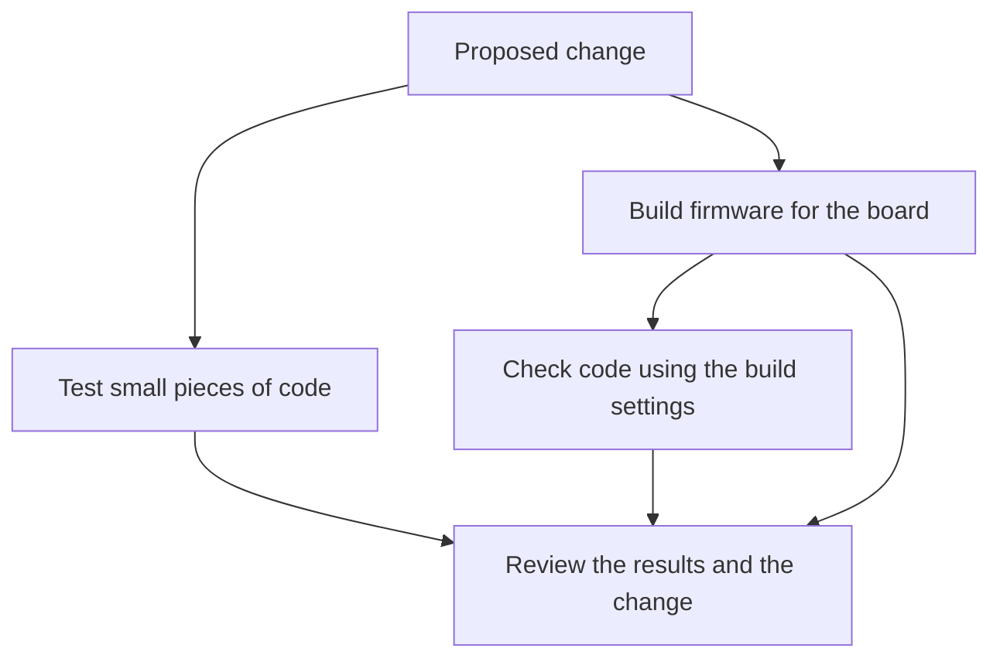
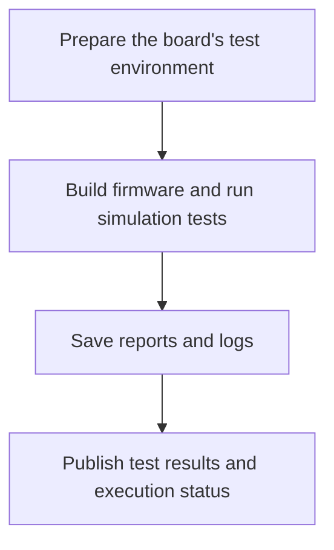
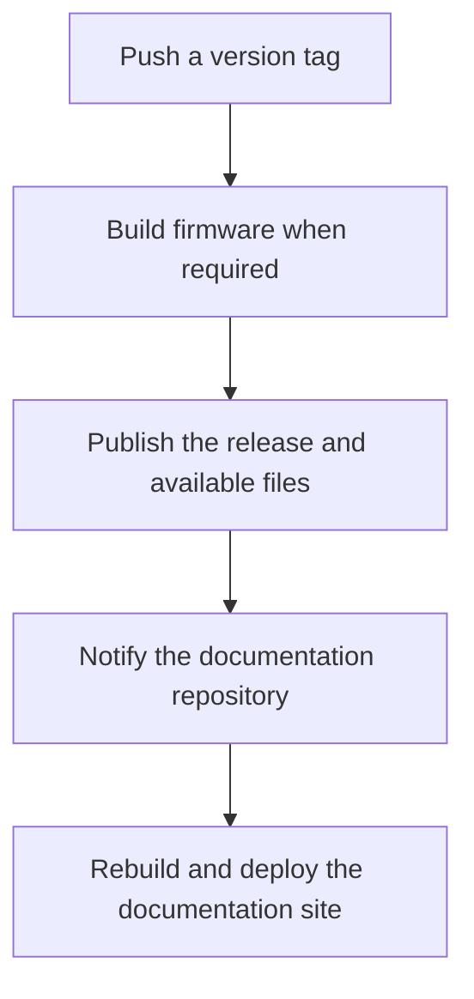

# How we check and release our software

SOFTWARE DEVELOPMENT

Before we put a software change on the car, we need to check what it does.

GitHub runs tests and builds when we propose changes to our code. It records the results so another team member can review them. We keep the shared instructions for those checks in one repository and use them across our projects.

<strong>6</strong>shared workflows that repositories can call

<strong>10</strong>repositories targeted by tooling updates

Reviewed on 19 October 2026. These figures describe the configured workflows and update targets, not successful runs.

A **workflow** is a set of instructions for GitHub to carry out, such as building firmware or running tests. The collection is often called **CI/CD**: continuous integration and continuous delivery. In our case, that means checking proposed changes and preparing versioned releases.

The diagram shows the usual firmware checks. They answer different questions, so we use them together.

<a href="#follow-a-software-change">Follow a change ↓</a><a href="#publishing-a-release">See the release process ↓</a><a href="/architecture/github-reference.html">Find configuration details →</a>

## What each check tells us

UNIT TESTS<h3>Check a small piece of behaviour</h3>
Give a function known inputs and compare its output with the expected result. These tests run on a development computer.

FIRMWARE BUILD<h3>Build the program for the board</h3>
Compile the source into firmware for the microcontroller. This catches missing files, incompatible interfaces, and other build errors.

CODE ANALYSIS<h3>Look for suspicious code</h3>
Check for patterns that may indicate a bug. This can find problems without having to execute the affected path.

SIMULATION<h3>Run firmware in an emulated system</h3>
Exercise repeatable scenarios and inspect how the firmware responds. This depends on the board model and tests that a repository provides.

A passing build means we can produce the firmware. A passing test means the tested behaviour matched its expected result. Neither establishes that every case was covered or that the physical board will behave correctly. We still need board and vehicle testing.

## Follow a software change

Suppose we change how a control unit handles a sensor reading. We want to check the calculation, confirm the firmware still builds, and give the reviewer enough information to assess the change.

### Propose the change

The developer opens a **pull request**, which is a proposed change that another team member can review before it is merged into the shared code.

The repository decides which workflows run for that event. Most of our board repositories call shared workflows in `ARTTU-Software/.github` rather than keeping separate copies of the build and test instructions. This lets us update the common implementation in one place.

Our standard firmware caller starts the tests and the build at the same time. The code-analysis job waits for the build because it needs the compiler settings produced by that build.

The standard caller skips its tests and build while the pull request is marked as a draft. It starts them when the request is ready for review and cancels older runs when newer changes arrive. Other caller files can use different rules.

### Read the results

We use **Ceedling** to run C unit tests. A failed assertion shows where the actual result differed from the expected result. When coverage reporting is enabled, we also show which source code the tests exercised. Coverage helps locate gaps; it does not judge whether a test checked the right thing.

The firmware build uses ARM GCC, CMake, and Ninja. These tools compile and link the program for the microcontroller. GitHub saves the resulting firmware and related files as a downloadable **artifact**. That includes the executable, binary, linker map, and compiler settings.

**Clang-Tidy** reads those compiler settings and checks the changed source for selected patterns. Its findings appear in the job results and review comments. The analysis job fails when it reports findings under the configured checks.

| If you want to know… | Look at… |
| --- | --- |
| Why a unit test failed | The test result and failed assertion |
| Which code the tests exercised | The coverage summary, when enabled |
| Whether firmware was produced | The build result and `stm32-artifacts` download |
| What the code checker found | The Clang-Tidy summary and review comments |
| What happened during a simulation | The Renode result and its saved reports |

The exact commands, file paths, and workflow inputs are in the [workflow reference](/architecture/github-reference). Repository settings decide which checks must pass before a change can be merged.

## Running firmware in Renode

Unit tests usually check individual pieces of code. **Renode** lets us run firmware in an emulated machine and test interactions over time. A test can set up a scenario, let the firmware run, and check its response.

The shared Renode workflow first runs the board’s setup, build, and test commands on a configured Linux runner. A **runner** is the machine that carries out a GitHub job. The workflow saves test reports and logs, then uses a separate GitHub-hosted runner to publish the results.

Keeping publication separate means the machine running the simulation does not need permission to write pull-request comments. Reports are retained for 14 days so a developer can inspect a failure after the run.

The published status also reports when execution failed or no test report was produced. A setup error should not be mistaken for a test that passed.

### Where simulation is available

The central tooling update includes a Renode caller, but that does not mean every target repository has adopted it or has board tests ready to run. The default build command only checks the infrastructure. Useful board testing requires the right firmware build, machine model, and assertions.

BMS-Master and STM32-Template have shared Renode callers in the revisions reviewed for this page. Telemetry has its own Docker-based simulation workflow. The [repository snapshot](/architecture/github-reference#repository-adoption-snapshot) records these differences and the inspected revisions.

The shared caller can be run manually or for a pull request from the same repository. It excludes fork pull requests. Repository variables select the runner, commands, paths, and number of test workers; `RENODE_ENABLED=false` turns it off. These settings are listed in the [Renode reference](/architecture/github-reference#renode-execution-and-reporting).

## Publishing a release

After a change has been reviewed, we can publish a versioned release. In the repositories that use our release callers, pushing a tag such as `v1.2.3` starts a separate workflow. A **tag** names a particular revision of the code.

Firmware release callers normally build the program first. The release workflow then creates a GitHub release, generates notes, and attaches available firmware files. Shared libraries and applications can publish a release without requesting firmware artifacts.

Artifact downloads are optional in the release workflow. A release can therefore be published without the expected firmware files if the download failed or no files matched. Check the release assets before using them.

### Updating the documentation site

The shared release workflow sends a `docs-release` notification to the documentation repository. That repository owns the site’s deployment. It can also deploy after a push to its `main` branch or a manual request.

The site reads product documentation through Git submodules, which record a particular revision of another repository. During deployment, product submodules follow the site’s release-tag policy. The central `.github` documentation submodule stays at the commit recorded by the hub.

The [publishing guide](/getting-started/publishing-docs) explains how to update those references. Deployment credentials and server procedures belong with the repository that performs the deployment.

## Updating the tools across repositories

The reusable build and test workflows are called from the central repository. Some development tools instead need files copied into each project: assistant instructions, skills, local checking programs, and the Renode caller.

We maintain a list of ten update targets: CAN-Gateway, ECU, Dashboard, Telemetry, LVSOC-26, Galvanic-Isolator, common, BMS-Master, STM32-Template, and utilities. The first eight target `dev`; the template and utilities target `main`.

When relevant tooling changes reach central `main`, the synchronization workflow checks the files to distribute and proposes updates to the targets through pull requests. Each target runs separately, so a failure for one repository does not cancel the others.

The workflow uses a GitHub App identity to create those requests. It batches the files into one commit, adds labels, and tries to mark the request as a draft. The conversion can fail, so its result needs checking. A developer must still review and merge the update; being on the target list does not mean a repository already has it.

The [agent harness page](/architecture/agentic-harness) explains what the assistant instructions and local checks do.

## Checking the shared tools themselves

We also test the automation in the central repository. Harness tests run on Windows and Linux. Separate tests check the expected structure and reporting behaviour of the Renode workflows. A source-policy check compares relevant changes against the selected Git revision.

These tests help us maintain the shared tooling. The board repositories still need their own test suites, builds, and simulation scenarios.

## Other repository workflows

Some projects need checks beyond the shared firmware sequence:

- **common** regenerates CAN definitions from the DBC message-description file and checks that the committed headers match the generated result.
- **utilities** publishes releases without a board firmware build in its top-level workflows.
- **Backend** has an independent deployment on pushes to `main`, which connects to the server over SSH and runs its deployment script.
- **documentation** owns the website build, deployment, and rules for selecting documentation revisions.

The inspected product repositories also use shared label rules. Labels identify changes to C/C++, Python, documentation, drivers, and other file groups. They help organise a pull request; they are not a code check.

## Configuration and earlier documentation

The [workflow reference](/architecture/github-reference) contains the full input tables, permissions, report locations, repository snapshot, and troubleshooting notes. It also lists all eight central workflow files, including the six that other workflows can call.

The [historical page](/architecture/github-history) preserves the complete previous documentation and diagrams. It is marked historical because some counts and repository details have changed.

We maintain the current pages in `.github/docs/ci/`, alongside the shared workflows. The documentation hub reads them through its submodule and keeps the existing public URL.

