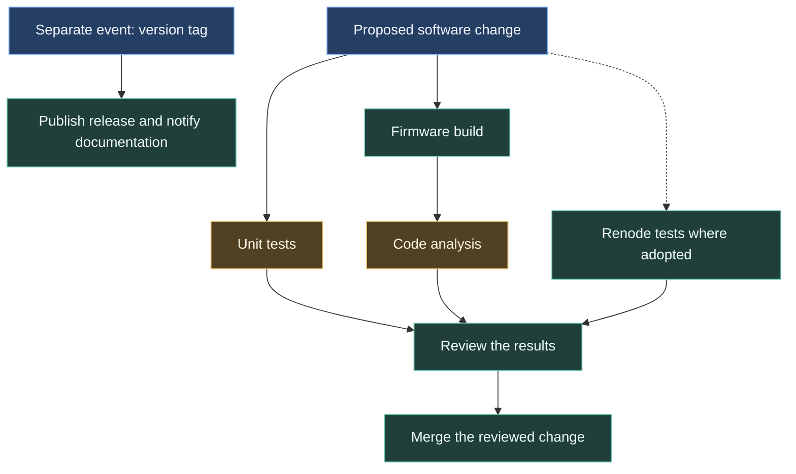
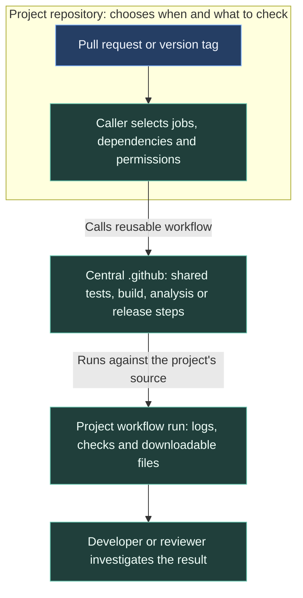

# How we check and release our software

GitHub runs tests and builds when we propose changes to our code. It records the results so another team member can review them. We keep the shared instructions for those checks in one repository and use them across our projects.

A **workflow** is a set of instructions for GitHub to carry out, such as building firmware or running tests. The collection is often called **CI/CD**: continuous integration and continuous delivery. In our case, that means checking proposed changes and preparing versioned releases.

The diagram shows the usual firmware checks. They answer different questions, so we use them together.

## Follow one procedure

Open the **GitHub CI/CD** group in the sidebar. Each procedure has its own page: first a diagram of what starts it and what it produces, then the explanation and configuration details.

| Procedure | What happens |
| --- | --- |
| [Firmware pull requests](/architecture/ci/pull-requests) | Start tests and builds, wait for analysis, then review the results |
| [Unit tests and coverage](/architecture/ci/unit-tests) | Compare code behaviour with expected answers and collect reports |
| [Firmware build](/architecture/ci/firmware-build) | Compile for STM32 and save firmware and compiler settings |
| [Code analysis](/architecture/ci/static-analysis) | Inspect changed code using the build settings |
| [Renode simulation](/architecture/ci/renode) | Run configured firmware scenarios in an emulated machine |
| [CAN header generation](/architecture/ci/generated-can) | Check that generated C headers match the DBC and generator |
| [Release publication](/architecture/ci/releases) | Publish a tagged version and notify the documentation repository |
| [Documentation deployment](/architecture/ci/documentation-deployment) | Select documentation revisions, build the website and update its container |
| [Backend deployment](/architecture/ci/backend-deployment) | Ask the production server to run its deployment script |
| [PR labels](/architecture/ci/labels) | Categorise changed files to help reviewers |
| [Tooling sync](/architecture/ci/tooling-sync) | Propose shared instruction, skill and hook updates to other repositories |
| [Harness checks](/architecture/ci/harness-checks) | Test local checks and workflow reporting before distribution |

## Follow a software change

Suppose we change how a control unit handles a sensor reading. The unit tests check selected calculations, the build confirms that the firmware can be produced, and analysis highlights suspicious code for the reviewer. Renode adds repeatable scenarios where a board has adopted it.

The standard firmware caller skips tests and builds for draft pull requests. When a request is ready for review, it starts them and cancels older runs when another commit arrives. Analysis waits for the build because it needs that build's compiler settings.

A reviewer reads the code and the check results together. A passing test covers the cases it exercised; it does not establish every possible behaviour. Board and vehicle tests remain part of assessing a firmware change.

## Shared instructions, repository-owned events

A **caller** is the small workflow in a project repository that chooses when to request a shared procedure. The central .github repository keeps the reusable implementation. For example, the same build procedure can serve a pull request and a tagged release.

Some procedures belong entirely to one repository, such as common's CAN header check and the Backend deployment. Their pages identify the owning workflow rather than implying that all repositories run them.

See [repository coverage and troubleshooting](/architecture/github-reference) for the inspected adoption snapshot and where to look when a check fails. These pages are maintained in `.github/docs/ci/`; the documentation site reads the recorded central commit through its submodule.
