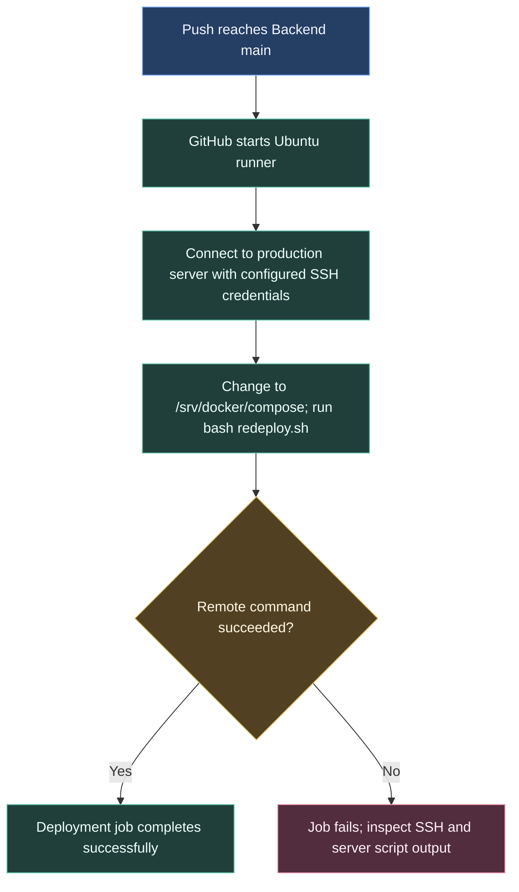

# Deploying the backend

The Backend repository has its own deployment procedure. A push to its main branch asks the production server to run the server's redeployment script.

## What the workflow tells us

The checked-in workflow defines the connection and command. The server's `redeploy.sh` controls the actual update. Health checks, rollback and database migration behaviour therefore need to be documented with the server procedure.

This deployment starts on a push to main. Publishing a release is a separate operation.

## Configuration and investigation

The workflow reads `PROD_HOST`, `PROD_USER` and `PROD_PASSWORD` from repository secrets and uses `appleboy/ssh-action`. For connection failures, inspect the SSH step and runner-to-server access. If the script starts and fails, use its output and the server's deployment records.

Source: [Backend deployment workflow](https://github.com/ARTTU-Software/Backend/blob/main/.github/workflows/deploy.yml). Keep server commands and credential changes in that repository.

[Back to CI/CD overview](/architecture/github)
