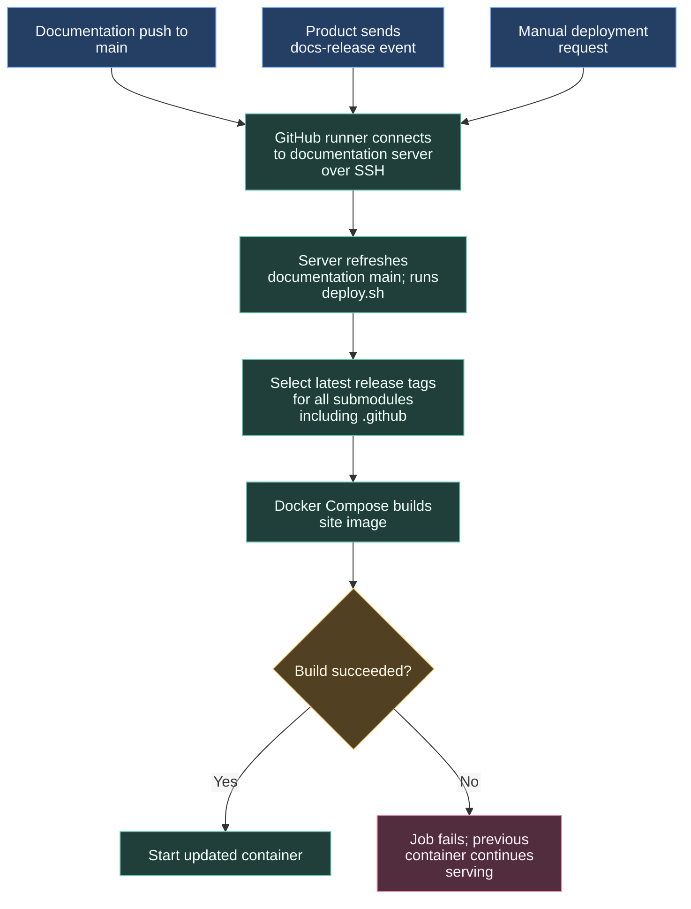

# Updating the documentation website

The documentation repository gathers project pages and builds the VitePress website. A product release can request a refresh; changes to the site's main branch and manual requests start the same deployment.

## Which documentation is published

Git submodules record a specific commit from another repository. Deployment fetches product submodules and selects the latest `v*` tag using Git's version sorting. A product without a matching tag stays at its existing revision.

The central .github repository publishes versioned release tags through its release workflow and sends the docs-release dispatch to the documentation repository, triggering server-side tag checkout and container rebuild just like product repositories.

## Server handoff and failure evidence

The GitHub runner performs the SSH handoff. The server has repository access and performs checkout, submodule selection and container build. The workflow serialises requests with `cancel-in-progress: false`.

If the site remains old, inspect the product notification, documentation deployment log, selected tags and central submodule pointer. The notification identifies a product and tag, but deploy.sh applies its own revision-selection policy.

Server credentials and operations stay with the documentation repository. See [publishing documentation](/getting-started/publishing-docs), [deploy workflow](https://github.com/ARTTU-Software/documentation/blob/main/.github/workflows/deploy.yml) and [deploy.sh](https://github.com/ARTTU-Software/documentation/blob/main/deploy.sh).

[Back to CI/CD overview](/architecture/github)
