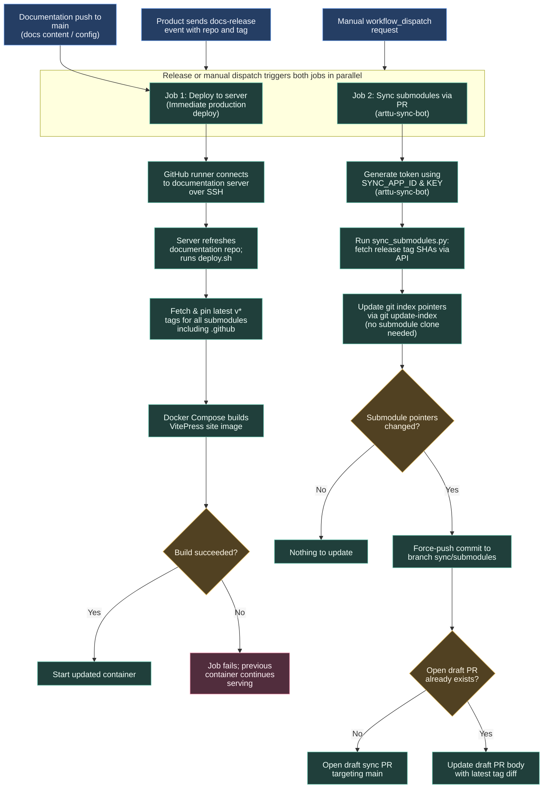

# Updating the documentation website

The documentation repository gathers project pages and builds the VitePress website. A product release can request a refresh; changes to the site's `main` branch and manual requests start the same deployment pipeline.

To allow developers to create release tags frequently across ecosystem repositories without polluting `main` with hundreds of automated commits, the documentation workflow uses a dual-path architecture:
1. **Immediate Production Server Deployment:** Deploys the latest tagged documentation directly to the live server over SSH immediately upon release.
2. **Submodule Synchronization PR:** Opens and continuously updates a single Draft Pull Request on the branch `sync/submodules` using `arttu-sync-bot` to advance the recorded submodule commit pointers in Git.

## Which documentation is published

Git submodules record a specific commit SHA from another repository. 

- On the **server**, `deploy.sh` executes `git fetch --tags --force --prune origin` inside each submodule and checks out the highest version matching `v*` (using Git version sorting `-v:refname`). A repository without a matching tag stays at its existing revision.
- In the **documentation repository**, Git submodule tree pointers (mode `160000`) must also be advanced so developers cloning the repo or inspecting GitHub see the current documentation. This synchronization is handled by the automated PR job.

The central `.github` repository publishes versioned release tags through its release workflow and sends the `docs-release` dispatch to `ARTTU-Software/documentation`, triggering server-side tag checkout and container rebuild just like product repositories.

## Immediate server deploy (`deploy.sh`)

The GitHub Actions runner executes `appleboy/ssh-action@v1` to trigger `deploy.sh` directly on the documentation server.
- The server has local repository access to the private organization and performs checkout, tag selection, and Docker Compose image builds.
- The workflow serializes requests with concurrency setting `group: deploy-docs` and `cancel-in-progress: false`, ensuring overlapping release events queue cleanly rather than aborting an active Docker build.
- If a build fails, `deploy.sh` exits non-zero, CI marks the step as failed, and the previously running Docker container continues serving traffic without downtime.

## Submodule synchronization via PR (`arttu-sync-bot`)

To avoid polluting the commit history on `main` when tags are created frequently:
1. `actions/create-github-app-token` generates an installation token for **`arttu-sync-bot`** scoped to `ARTTU-Software/documentation` using secrets `SYNC_APP_ID` and `SYNC_APP_PRIVATE_KEY` (with a fallback to `DOCS_DISPATCH_TOKEN`).
2. `scripts/sync_submodules.py` reads `.gitmodules` and queries the GitHub REST API (`/repos/{owner}/{repo}/tags`) for the commit SHA corresponding to the latest semantic version tag.
3. The script stages updated submodule commit pointers using `git update-index --cacheinfo 160000,<sha>,<path>`. This updates Git's index directly in seconds without requiring full recursive submodule clones or runner SSH keys.
4. If submodule pointers changed, the workflow commits as `arttu-sync-bot[bot]` and force-pushes to the branch `sync/submodules`.
5. If no pull request is open for `sync/submodules`, `gh pr create` opens a new Draft PR targeting `main`. If a PR is already open, `gh pr edit` refreshes its description with the latest submodule differences.
6. When maintainers want to persist the updated submodule pointers in `main`, they can mark the Draft PR as ready and merge it.

## Workflow contract and secrets

Source: [`deploy.yml`](https://github.com/ARTTU-Software/documentation/blob/main/.github/workflows/deploy.yml) in `ARTTU-Software/documentation`.

| Secret | Purpose | Owning Repository |
| --- | --- | --- |
| `SERVER_HOST` | SSH host for the documentation server | `documentation` |
| `SERVER_USER` | SSH user with Docker permissions | `documentation` |
| `SERVER_PASSWORD` | SSH authentication credential | `documentation` |
| `SYNC_APP_ID` | GitHub App ID for `arttu-sync-bot` | `documentation` (shared from `.github`) |
| `SYNC_APP_PRIVATE_KEY` | Private PEM key for `arttu-sync-bot` | `documentation` (shared from `.github`) |
| `DOCS_DISPATCH_TOKEN` | Organization PAT used as fallback auth and cross-repo dispatch trigger | `documentation` & caller repos |

## Failure evidence and troubleshooting

| Symptom | Inspect first |
| --- | --- |
| Site remains old after release | Product notification step (`create-release.yml`), documentation deployment run log, and selected tags in `deploy.sh` |
| Server deploy fails during Docker build | Runner SSH action log, VitePress markdown compilation errors, and broken image assets |
| Submodule sync PR is not created or updated | `sync-submodules-pr` job logs, `SYNC_APP_ID` / `SYNC_APP_PRIVATE_KEY` secrets, and GitHub CLI output |
| Submodule pointer points to wrong commit | GitHub API tag resolution in `scripts/sync_submodules.py` output; ensure tag follows semantic versioning (`v*`) |

Server credentials and operations stay with the documentation repository. See [publishing documentation](/getting-started/publishing-docs), [deploy workflow](https://github.com/ARTTU-Software/documentation/blob/main/.github/workflows/deploy.yml) and [deploy.sh](https://github.com/ARTTU-Software/documentation/blob/main/deploy.sh).

[Back to CI/CD overview](/architecture/github)
