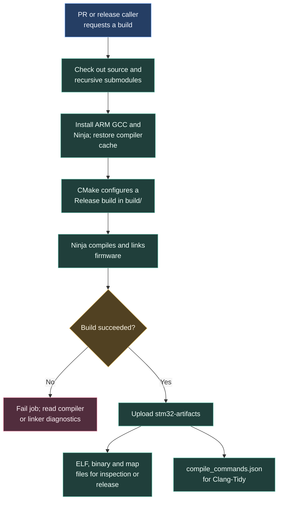

# Building STM32 firmware

The build turns source code into a program for the board's microcontroller. It also records compiler settings so the analysis job can understand the same headers and options.

## What the files are for

The **ELF** contains the linked program and information used by debugging tools. The **binary** is a raw firmware image. The **map** lists how code and data occupy memory. `compile_commands.json` records the command used to compile each source file.

The caller passes this artifact to [code analysis](/architecture/ci/static-analysis) or [release publication](/architecture/ci/releases). A successful compilation checks that this configuration can be built; [unit tests](/architecture/ci/unit-tests) check behaviour separately.

## If the build fails

Find the first compiler or linker error in **Compile Project**. Missing headers can come from source paths or submodules. Undefined symbols need checking against the source list and linked libraries. A CMake failure happens earlier, during configuration.

If expected firmware files are absent, inspect the artifact upload log and project output paths. The upload step warns about missing files rather than making their absence a build failure.

## Workflow contract

| Setting | Current value |
| --- | --- |
| Inputs | None |
| Runner | `ubuntu-latest` |
| Toolchain | ARM GCC action with `release: latest` |
| Configuration | CMake and Ninja, `Release`, `build/` |
| Toolchain file in caller | `cmake/gcc-arm-none-eabi.cmake` |
| Firmware version | `github.ref_name` |
| Compiler cache | ccache, 500 MiB maximum, OS/STM32 key |
| Artifact | `stm32-artifacts` |
| Files | `build/**/*.elf`, `build/**/*.bin`, `build/**/*.map`, `build/compile_commands.json` |

C and C++ compiler launchers use ccache to reuse previous compilation results when possible. Checkout includes recursive submodules.

Source: [stm32-build.yml](https://github.com/ARTTU-Software/.github/blob/main/.github/workflows/stm32-build.yml).

[Back to CI/CD overview](/architecture/github)
