# CAN database sync and generated headers

The common library maintains the CAN message definitions for the vehicle network, storing the CAN message-description file (`MAIN_DBC.dbc`) alongside generated C board and signal headers. Two procedures keep definitions reliable: an automated hourly SharePoint sync that tests, tags, and releases new definitions, and a pull-request check that prevents committed headers from drifting from the DBC.

```mermaid
%%{init: {"htmlLabels": false}}%%
flowchart TB
    subgraph SYNC["SharePoint CAN database sync (can_sync.yml)"]
        TRIGGER["Hourly cron or<br/>manual dispatch"] --> DOWNLOAD["Download workbook from<br/>SharePoint via secret"]
        DOWNLOAD --> VALIDATE["Validate workbook and<br/>generate DBC and headers"]
        VALIDATE --> SYNTAX["Verify C11 syntax<br/>compilation of headers"]
        SYNTAX --> ARTIFACT["Upload can-database<br/>run artifact"]
        ARTIFACT --> CHANGED{"Definitions<br/>changed?"}
        CHANGED -->|No| UNCHANGED["Finish run without<br/>commit or tag"]
        CHANGED -->|Yes| CEEDLING["Run Ceedling C<br/>regression tests"]
        CEEDLING --> PUBLISH["Atomically commit to<br/>main and create tag"]
        PUBLISH --> RELEASE["Dispatch release.yml<br/>with new tag"]
        RELEASE --> ASSETS["Attach DBC, headers<br/>and source manifest to release"]
        RELEASE --> DOCS["Notify documentation<br/>via docs-release event"]
    end

    subgraph PR["PR DBC verification (dbc_codegen.yml)"]
        PR_EVENT["PR touches DBC,<br/>generator or headers"] --> REGEN["Run dbc_to_c_builder.py"]
        REGEN --> DIFF["Compare generated<br/>headers with committed"]
        DIFF --> MATCH{"Headers match?"}
        MATCH -->|Yes| PASS["Pass: committed output<br/>matches generator"]
        MATCH -->|No| FAIL["Fail: regenerate locally<br/>and review differences"]
    end

    classDef event fill:#253e64,stroke:#82b4ff,color:#f3f7ff
    classDef work fill:#203f3b,stroke:#66c5ae,color:#f0fff9
    classDef check fill:#514122,stroke:#e8bf63,color:#fff8e8
    classDef failure fill:#512d3d,stroke:#ef91ac,color:#fff1f6
    class TRIGGER,PR_EVENT event
    class DOWNLOAD,VALIDATE,SYNTAX,ARTIFACT,UNCHANGED,CEEDLING,PUBLISH,RELEASE,ASSETS,DOCS,REGEN,DIFF,PASS work
    class CHANGED,MATCH check
    class FAIL failure
```



## Automated SharePoint CAN sync (`can_sync.yml`)

The SharePoint workbook remains the master editable source for the vehicle CAN network. The automated sync workflow downloads the latest saved workbook, converts it to DBC and C headers, runs tests, and publishes a new release when definitions change.

### Sync steps

1. **Workbook download:** Downloads the latest workbook using a SharePoint sharing link stored in the repository Actions secret `CAN_WORKBOOK_URL`. It validates the downloaded payload, rejecting sign-in pages, HTML errors, and corrupt files.
2. **Validation and code generation:** Runs `tools/can_sync/pipeline.py prepare`. It parses message rows (`BO_`) and signal rows (`SG_`), checks standard (11-bit) and extended (29-bit) message IDs, multiplexing, and scaling, and generates:
   - `MAIN_DBC.dbc`
   - `drivers/can/can_board_defs.h`
   - `drivers/can/can_signal_defs.h`
   - `can-database-source.json` (SHA256 provenance hashes)
   An independent strict check is performed using `cantools`.
3. **C11 compilation check:** Compiles `#include "can_board_defs.h"` with `-std=c11 -Wall -Wextra -Werror -fsyntax-only` to ensure the generated C definitions are syntactically valid before continuing.
4. **Downloadable artifact:** Always uploads the `can-database` artifact containing the DBC, headers, and manifest. Anyone on the team can download the latest DBC directly from the Actions run without waiting for a commit or release.
5. **C regression tests:** If definitions have changed, the workflow sets up Ruby and runs `bundle exec ceedling test:all`. Bundler's `BUNDLE_GEMFILE` is kept outside the git checkout so generated lockfiles do not dirty the repository.
6. **Atomic commit and version bump:** Commits generated definitions directly to `main` with commit message `chore(can): sync SharePoint database (vX.Y.Z)` and atomically increments the patch tag (e.g. `v1.5.0` to `v1.5.1`). Unrelated modified or untracked files cause the publisher to abort.
7. **Release and documentation notification:** Pushes made by `GITHUB_TOKEN` do not trigger tag push events. The sync workflow therefore explicitly dispatches `release.yml --ref <tag>`. The release workflow attaches `MAIN_DBC.dbc`, the headers, and `can-database-source.json` to the GitHub release, and calls `create-release.yml` to send a `docs-release` repository dispatch to `ARTTU-Software/documentation`, triggering a documentation server update over SSH.

### Concurrency and configuration

- **Concurrency:** Manual and scheduled runs share concurrency group `can-database-main` with `cancel-in-progress: false` to ensure a publication run is never interrupted.
- **Schedule:** Runs hourly at minute 17 UTC when repository variable `CAN_SYNC_ENABLED` is set to `true`.
- **Manual execution:** Can be triggered at any time from Actions → **Sync CAN database** → **Run workflow** on `main`.

## Pull-request DBC verification (`dbc_codegen.yml`)

The pull-request workflow runs when a branch changes `MAIN_DBC.dbc`, `dbc_to_c_builder.py`, `drivers/can/can_signal_defs.h`, or `drivers/can/can_board_defs.h`.

It regenerates the C headers from the checked-out DBC and runs:

```sh
python dbc_to_c_builder.py
git diff --exit-code -- drivers/can/can_signal_defs.h drivers/can/can_board_defs.h
```

If the committed headers do not match the generator output, the check fails. Developers must regenerate locally, review the differences, and commit both the DBC and the matching headers together.

## Workflow sources

- SharePoint sync: [can_sync.yml](https://github.com/ARTTU-Software/common/blob/main/.github/workflows/can_sync.yml)
- PR DBC verification: [dbc_codegen.yml](https://github.com/ARTTU-Software/common/blob/main/.github/workflows/dbc_codegen.yml)
- Release caller: [release.yml](https://github.com/ARTTU-Software/common/blob/main/.github/workflows/release.yml)
- Detailed sync guide: [can-database-sync.md](https://github.com/ARTTU-Software/common/blob/main/docs/can-database-sync.md)

[Back to CI/CD overview](/architecture/github)
