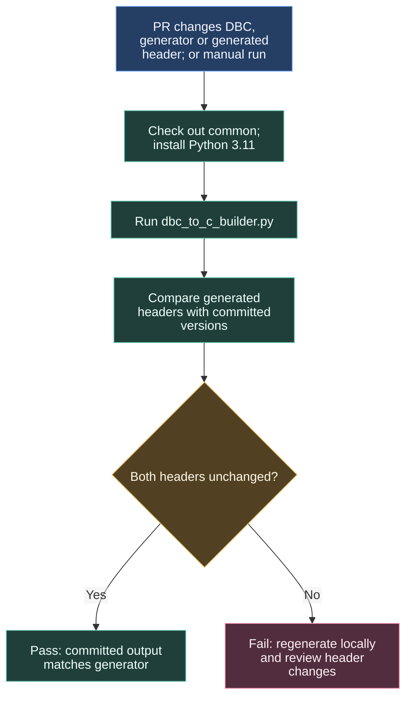

# Keeping generated CAN headers current

The common library stores a CAN message-description file, the DBC, alongside C headers generated from it. This check catches changes that update one without updating the other.



## What is compared

The workflow regenerates `drivers/can/can_signal_defs.h` and `drivers/can/can_board_defs.h` from the checked-out inputs, then runs:

```sh
python dbc_to_c_builder.py
git diff --exit-code -- drivers/can/can_signal_defs.h drivers/can/can_board_defs.h
```

A difference fails the job. Regenerate locally, review the changes, and commit the intended headers with the DBC or generator update. This confirms agreement with the generator; vehicle CAN interface requirements need their own review.

## Trigger and ownership

The PR path filter covers `MAIN_DBC.dbc`, `dbc_to_c_builder.py` and the two headers. A manual run is also available. The job uses Ubuntu, Python 3.11 and contents-read permission. This procedure belongs to common, alongside its unit tests and release caller.

Source: [common DBC workflow](https://github.com/ARTTU-Software/common/blob/dev/.github/workflows/dbc_codegen.yml).

[Back to CI/CD overview](/architecture/github)
