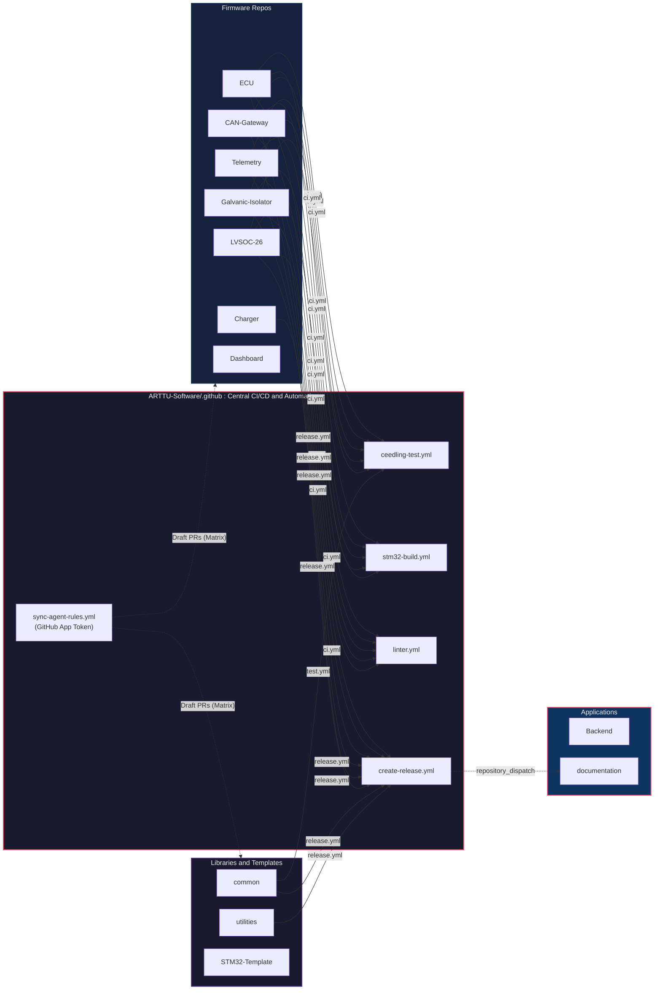
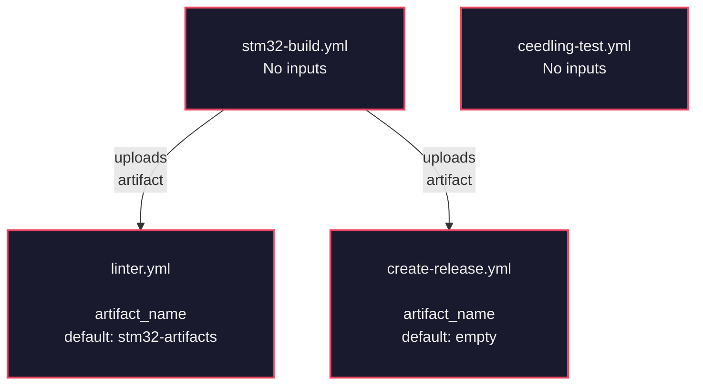
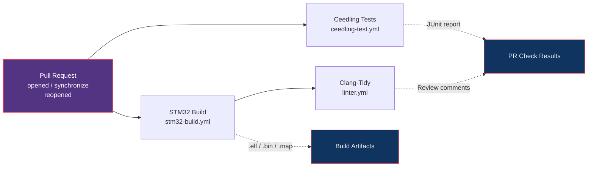
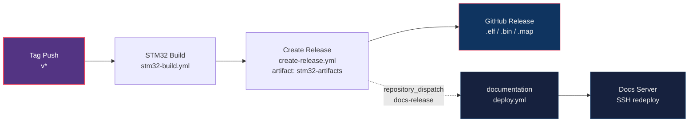
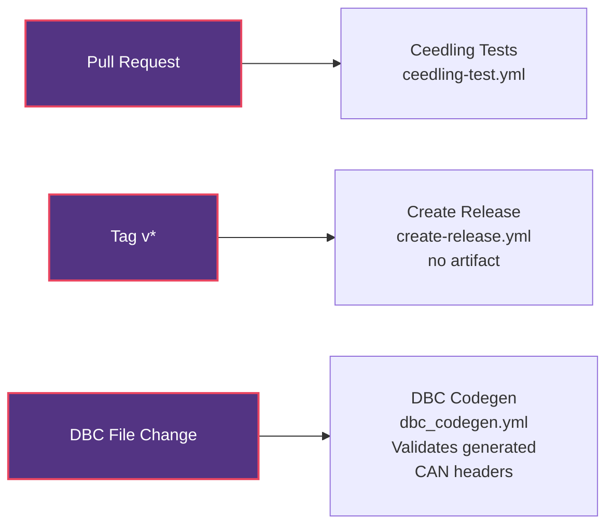
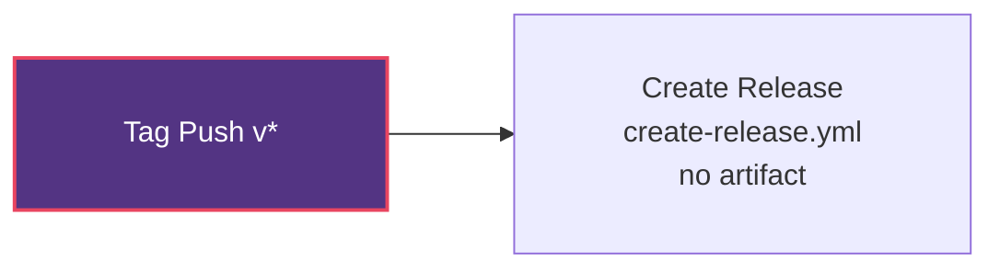
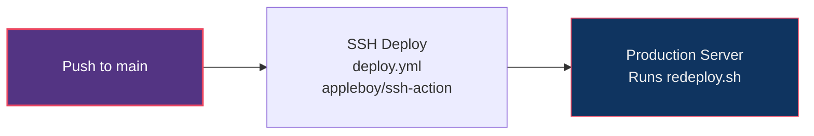
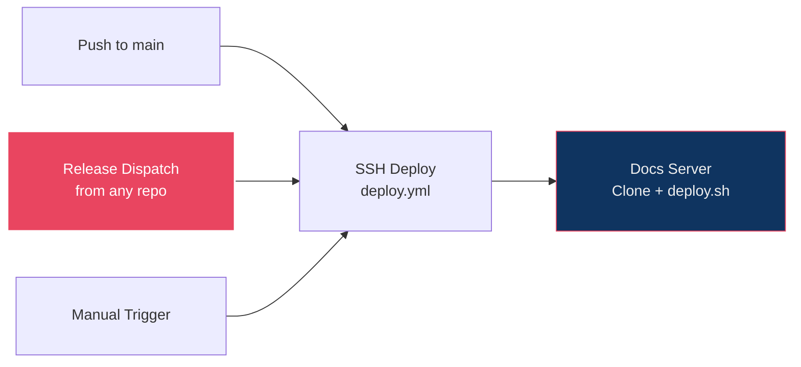
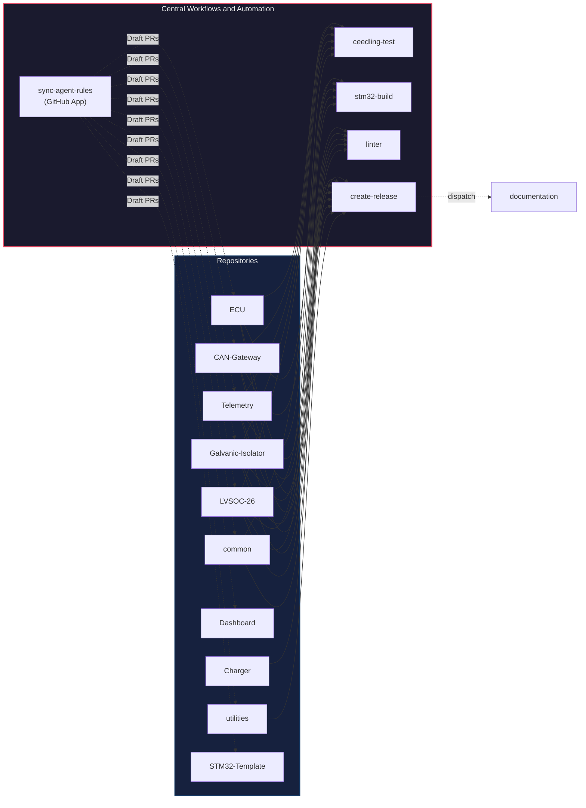

> **Historical reference, preserved on 19 October 2026.** The original page is retained below in full, including its diagrams and repository matrix. Its counts, adoption claims, inputs, and implementation details describe an older state. Use the [current CI/CD architecture](./README.md) and [workflow reference](./reference.md) for current behavior. Repository deployment details remain owned by their respective repositories.

# GitHub CI/CD Architecture

All automation is built on central workflows hosted in the [`.github`](https://github.com/ARTTU-Software/.github) repository, which individual project repositories call into or receive automated updates from.

## 1. High-Level Overview

The organization follows a **hub-and-spoke model**:
1. **Central Reusable Workflows**: Four reusable workflows live in the central `.github` repository. Individual board repositories invoke them on pull requests and tag pushes.
2. **Automated Cross-Repo Sync Pipeline**: A central event-driven workflow synchronizes AI agent guidelines, hooks, and skills across 9 organization repositories, opening draft pull requests authenticated through an organization GitHub App.
3. **Cross-Repo Dispatch Chain**: Firmware releases dispatch events to trigger automatic redeployment of our VitePress documentation hub.

---

## 2. Central Reusable Workflows

Reusable workflows are defined in [`ARTTU-Software/.github/.github/workflows/`](https://github.com/ARTTU-Software/.github) and invoked with `workflow_call`.

| Workflow | Trigger | Purpose | Key Actions Used |
| :--- | :--- | :--- | :--- |
| `ceedling-test.yml` | `workflow_call` | Runs [Ceedling](https://github.com/ThrowTheSwitch/Ceedling) C unit tests and publishes JUnit results to PRs | `ruby/setup-ruby`, `EnricoMi/publish-unit-test-result-action` |
| `stm32-build.yml` | `workflow_call` | Cross-compiles STM32 firmware with CMake + Ninja, uploads `.elf`/`.bin`/`.map` artifacts | `carlosperate/arm-none-eabi-gcc-action`, `hendrikmuhs/ccache-action` |
| `linter.yml` | `workflow_call` | Runs Clang-Tidy static analysis using the compile database from the build step | `cpp-linter/cpp-linter-action` (needs `stm32-build` artifact) |
| `create-release.yml` | `workflow_call` | Creates a GitHub Release, attaches firmware binaries, triggers a documentation rebuild | `softprops/action-gh-release`, `peter-evans/repository-dispatch` |

### Reusable Workflow Inputs

---

## 3. Firmware CI Pipeline (PR)

All firmware repositories with CI (**ECU**, **CAN-Gateway**, **Telemetry**, **Galvanic-Isolator**, **LVSOC-26**) share an identical `ci.yml` that runs a three-stage pipeline on every pull request. **Charger** and **Dashboard** currently do not run this pipeline.

> [!NOTE]
> The **linter** job depends on (`needs:`) the **build** job because it downloads `compile_commands.json` from the build artifacts. The **Ceedling tests** run in parallel with the build.

---

## 4. Firmware Release Pipeline

When a version tag (`v*`) is pushed to any firmware repo, the release pipeline builds the firmware and publishes a GitHub Release. For repos with a build step (ECU, CAN-Gateway, Telemetry, Galvanic-Isolator, LVSOC-26), firmware binaries are attached. Charger publishes a release without build artifacts.

---

## 5. Automated Cross-Repo Sync and PR Pipeline (`sync-agent-rules.yml`)

We maintain shared AI agent directives, skills, pre-tool hooks, and PR templates centrally in the `.github` repository. Whenever changes are merged to `main` in `.github`, an automated pipeline distributes these updates to 9 organization repositories by opening draft pull requests.

```mermaid
%%{init: {'flowchart': {'nodeSpacing': 35, 'rankSpacing': 55, 'padding': 20, 'curve': 'basis'}} }%%
flowchart LR
    subgraph trigger["Event Trigger (.github repo)"]
        direction TB
        TRG["Push to main / dispatch\n(AGENTS.md, skills, hooks)"]
    end

    subgraph auth["GitHub App Authentication"]
        direction TB
        APP["create-github-app-token@v1\n(SYNC_APP_ID and Private Key)"]
        TKN["Installation Token\n(Scoped cross-repo permissions)"]
        APP --> TKN
    end

    subgraph matrix["Parallel Sync Matrix (9 Targets)"]
        direction TB
        CFG["Generate sync-matrix.yml\n(Isolated target config)"]
        SYNC["repo-file-sync-action@v1\n(Single atomic commit)"]
        CFG --> SYNC
    end

    subgraph output["Automated Pull Request Lifecycle"]
        direction TB
        PR["Open PR on dev/main\n(chore(agents): ...)"]
        LBL["Add Labels\nautomation, agent-rules"]
        DFT["Convert to Draft\ngh pr ready --undo"]
        PR --> LBL --> DFT
    end

    TRG --> APP
    TKN --> CFG
    SYNC --> PR

    style trigger fill:#1a1a2e,stroke:#e94560,stroke-width:2px,color:#eee
    style auth fill:#16213e,stroke:#0f3460,stroke-width:2px,color:#eee
    style matrix fill:#1a1a2e,stroke:#533483,stroke-width:2px,color:#eee
    style output fill:#0f3460,stroke:#00adb5,stroke-width:2px,color:#eee
```

### GitHub App Authentication Architecture

The sync pipeline authenticates using a dedicated **GitHub App** (`actions/create-github-app-token@v1` using `SYNC_APP_ID` and `SYNC_APP_PRIVATE_KEY`) rather than a personal access token (PAT).

This architecture provides three concrete advantages:
* **Downstream Workflow Execution**: Under GitHub Actions security rules, events created by the default `GITHUB_TOKEN` or certain PAT configurations cannot trigger downstream workflows. Commits and pull requests generated using our GitHub App installation token successfully trigger target repository checks (including `ci.yml` and `labeler.yml`).
* **Short-Lived Scoped Credentials**: The minted installation token has a 60-minute lifespan and is restricted strictly to organization repositories installed on the app, avoiding persistent credentials.
* **Decoupled Identity**: Automation is owned by an organization app identity rather than a personal user account, preventing workflow breakage when personal access tokens expire.

### Parallelized Matrix Strategy

To prevent a failure on one target from aborting the remaining repositories, the workflow runs a parallel job matrix across 9 targets with `fail-fast: false`:

* `ARTTU-Software/STM32-Template@main`
* `ARTTU-Software/CAN-Gateway@dev`
* `ARTTU-Software/ECU@dev`
* `ARTTU-Software/Dashboard@dev`
* `ARTTU-Software/Telemetry@dev`
* `ARTTU-Software/LVSOC-26@dev`
* `ARTTU-Software/Galvanic-Isolator@dev`
* `ARTTU-Software/common@dev`
* `ARTTU-Software/utilities@main`

Each matrix job executes an inline Node.js step that reads `.github/sync.yml` and generates an isolated `.github/sync-matrix.yml` containing only that specific target. `COMMIT_EACH_FILE: false` batches all changed files into a single commit with the prefix `chore(agents): `.

### Automated Draft PR Lifecycle

When differences exist between `.github` and a target branch:
1. `repo-file-sync-action@v1` creates a branch and opens a pull request.
2. The pull request is automatically labeled with `automation` and `agent-rules`.
3. A follow-up step inspects the output pull request URL and runs `gh pr ready "$url" --undo` using the GitHub CLI and the App token.

> [!TIP]
> Automatically converting pull requests to draft status prevents unintended merges while allowing developers to inspect diffs and run local hardware verification before promoting to review.

---

## 6. Library Repo Pipelines

The **common** and **utilities** repos follow simpler patterns since they are shared libraries that do not produce standalone firmware binaries.

### common

### utilities

This repository runs release and labeler workflows without on-board firmware builds.

---

## 7. Application Repo Pipelines

### Backend

### Documentation

The documentation site has a three-trigger deploy pipeline:

---

## 8. Universal PR Labeler

Every repository in the organization has an identical `labeler.yml` workflow that auto-labels pull requests based on changed file types. The labeling rules are centrally defined in `ARTTU-Software/.github/.github/labeler.yml`.

| Label | File Patterns |
| :--- | :--- |
| `C/C++` | `*.c`, `*.cpp`, `*.h`, `*.hpp` |
| `TypeScript` | `*.ts`, `*.tsx` |
| `Python` | `*.py` |
| `Arduino` | `*.ino`, `*.pde` |
| `Driver` | `Drivers/**/*` |
| `CI/CD` | `.github/**/*` |
| `documentation` | `docs/**/*`, `*.md` |
| `Build System` | `CMakeLists.txt`, `*.cmake` |

---

## 9. Who Calls What

This diagram illustrates the invocation relationships between organization repositories, central reusable workflows, and the automated synchronization pipeline:

---

## 10. Repo Coverage Summary

| Repository | CI (PR) | Unit Tests | Release | Deploy | Labeler | Agent Rules Sync |
| :--- | :---: | :---: | :---: | :---: | :---: | :---: |
| **ECU** | build + lint | Ceedling | with firmware | None | Yes | Yes (Draft PR) |
| **CAN-Gateway** | build + lint | Ceedling | with firmware | None | Yes | Yes (Draft PR) |
| **Telemetry** | build + lint | Ceedling | with firmware | None | Yes | Yes (Draft PR) |
| **Galvanic-Isolator** | build + lint | Ceedling | with firmware | None | Yes | Yes (Draft PR) |
| **LVSOC-26** | build + lint | Ceedling | with firmware | None | Yes | Yes (Draft PR) |
| **Charger** | None | None | no artifact | None | Yes | None |
| **Dashboard** | None | None | None | None | Yes | Yes (Draft PR) |
| **common** | None | Ceedling | no artifact | None | Yes | Yes (Draft PR) |
| **utilities** | None | None | no artifact | None | Yes | Yes (Draft PR) |
| **STM32-Template** | None | None | None | None | Yes | Yes (Draft PR) |
| **Backend** | None | None | Yes | SSH | Yes | None |
| **documentation** | None | None | None | SSH | Yes | None |
| **Partners-Database-App** | None | None | None | None | None | None |
