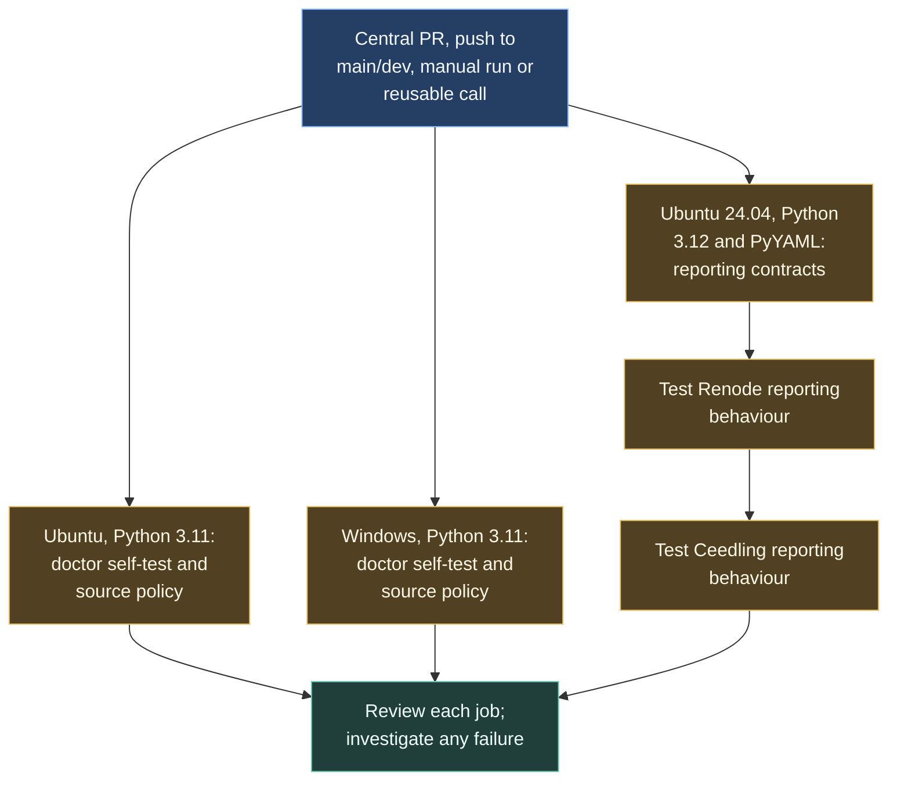
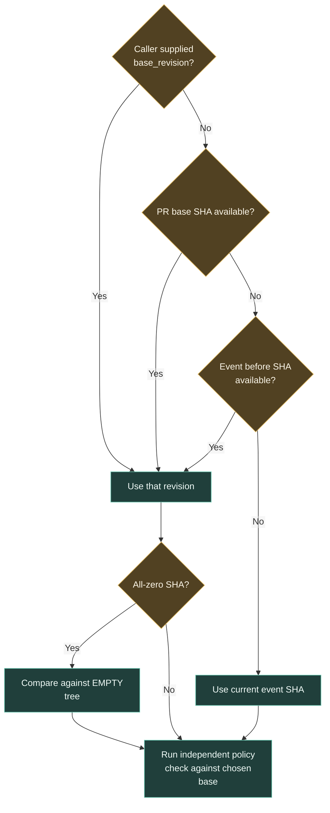

# Checking the shared harness

The central repository tests the assistant's local checks and the workflows that report test results. These checks help catch tooling failures before an update is distributed to board repositories.



## Why both operating systems run

Developers use local hooks on Windows and Linux. The matrix exercises setup and regression checks on both. A source-policy job compares the selected Git base with the working tree, independently of an assistant's account of its edits.

Reporting-contract tests inspect and exercise the Renode and Ceedling reporting logic. Board firmware scenarios still run in their own workflows.

## Selecting the comparison base

The workflow uses the first available revision in this order. An all-zero SHA is converted to `EMPTY` before the policy script runs.



`base_revision` is an optional string, empty by default. Using the current SHA may leave no earlier change range, so reusable callers should supply the intended base where needed.

## Local checks

```sh
python .agents/hooks/doctor.py --self-test
python .agents/hooks/verify_changes.py --base HEAD
python -m unittest discover -s .agents/tests -q
```

Use the actual PR base for a PR comparison. The workflow requests contents-read permission and preserves the policy script's failure exit code.

Source: [agent-harness-check.yml](https://github.com/ARTTU-Software/.github/blob/main/.github/workflows/agent-harness-check.yml). The filename is retained for compatibility.

[Back to CI/CD overview](/architecture/github)
