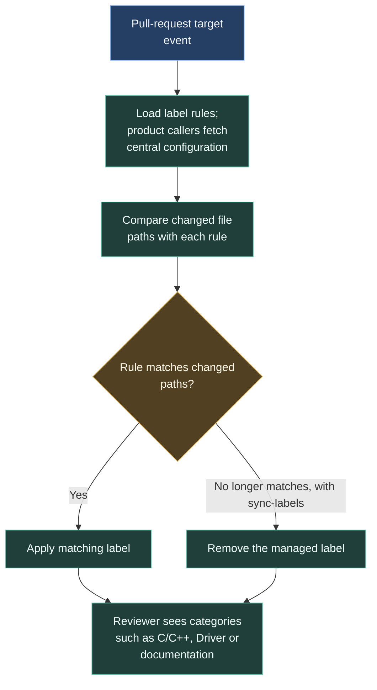

# Labelling pull requests

Labels help reviewers recognise which parts of a project changed. The labeler compares changed paths with shared rules and applies matching labels. It does not compile, test or approve the code.

## Permissions and investigation

The central job requests contents-read and pull-request-write permissions. It runs `actions/labeler` with `sync-labels: true`. Its `pull_request_target` event uses the target repository context; this job classifies paths without running the proposed code.

For a missing label, check the path against the patterns, then the caller's configuration fetch and labeler log.

Source: [central labeler workflow](https://github.com/ARTTU-Software/.github/blob/main/.github/workflows/labeler.yml).

## Shared rules

Source: [labeler.yml configuration](https://github.com/ARTTU-Software/.github/blob/main/.github/labeler.yml). Central and product labeler workflows use `pull_request_target`; product callers fetch the central repository’s configuration. Labeling classifies changed paths and does not validate code.

| Label | Patterns |
| --- | --- |
| `C/C++` | `**/*.c`, `**/*.cpp`, `**/*.h`, `**/*.hpp` |
| `TypeScript` | `**/*.ts`, `**/*.tsx` |
| `Python` | `**/*.py` |
| `Arduino` | `**/*.ino`, `**/*.pde` |
| `Driver` | `Drivers/**/*` |
| `CI/CD` | `.github/**/*` |
| `documentation` | `docs/**/*`, `**/*.md` |
| `Build System` | `**/CMakeLists.txt`, `**/*.cmake` |

[Back to CI/CD overview](/architecture/github)
