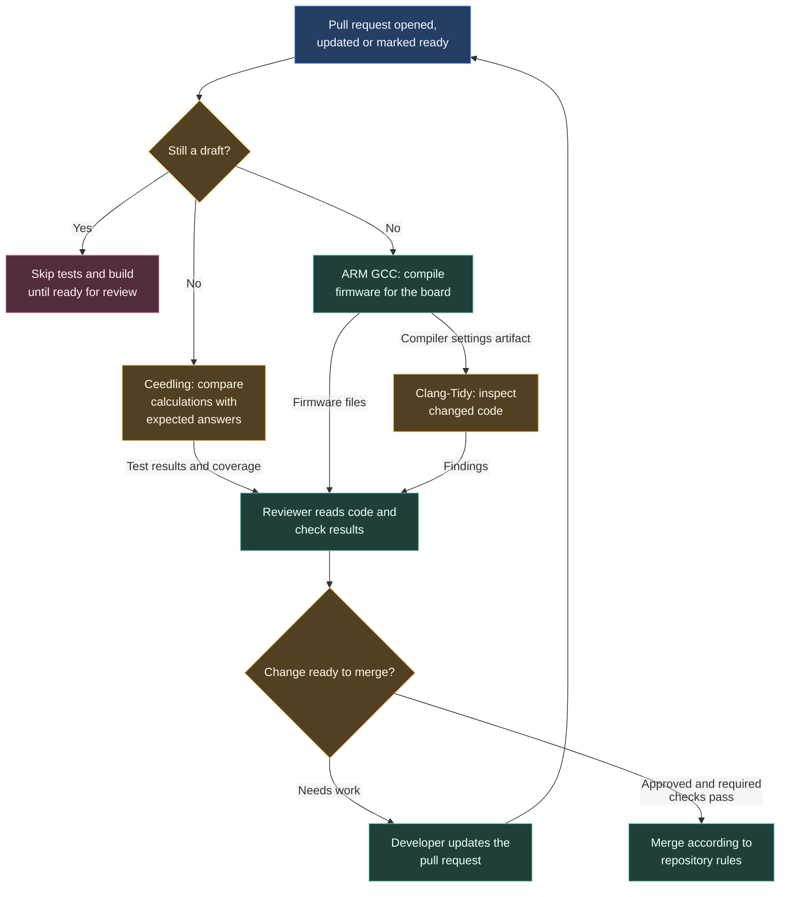

# Checking a proposed firmware change

A pull request lets another team member review a change before it joins the shared code. The standard firmware workflow checks the change in parallel, then adds code analysis once the build has produced its compiler settings.

For example, changing a sensor calculation starts the unit tests and firmware build independently. The diagram shows which work can start immediately and which must wait.

## Following the checks

Open the pull request's **Checks** view to see the individual jobs. A failed test points to a behaviour that did not match its expected result. A failed build means the compiler or linker could not produce firmware. Analysis findings need reading in the context of the change.

The caller cancels an older run when another commit arrives on the same workflow and ref. Use results for the latest commit when reviewing. If the build fails, its dependent analysis job cannot provide a fresh analysis result.

## Where the instructions live

The [STM32-Template caller](https://github.com/ARTTU-Software/STM32-Template/blob/main/.github/workflows/ci.yml) responds to PR events `opened`, `synchronize`, `reopened`, and `ready_for_review`. It skips unit tests and builds for draft requests and orders analysis with `needs: call-global-build`.

The caller selects the events, dependencies and permissions. The central `.github` repository supplies the reusable implementations. Current callers using `@main` pick up changes to that shared branch; they do not pin a released workflow version.

| Follow a procedure | What it answers |
| --- | --- |
| [Unit tests and coverage](/architecture/ci/unit-tests) | Do the tested calculations and decisions give the expected answers? |
| [Firmware build](/architecture/ci/firmware-build) | Can we produce a program for the board? |
| [Code analysis](/architecture/ci/static-analysis) | Does the changed code contain patterns worth investigating? |
| [Renode simulation](/architecture/ci/renode) | Do the configured scenarios behave as expected in an emulated machine? |

Renode uses a separate caller where adopted. The [repository snapshot](/architecture/github-reference#repository-adoption-snapshot) shows the inspected definitions. Required merge checks are repository settings; a workflow file alone does not establish them.

[Back to CI/CD overview](/architecture/github)
