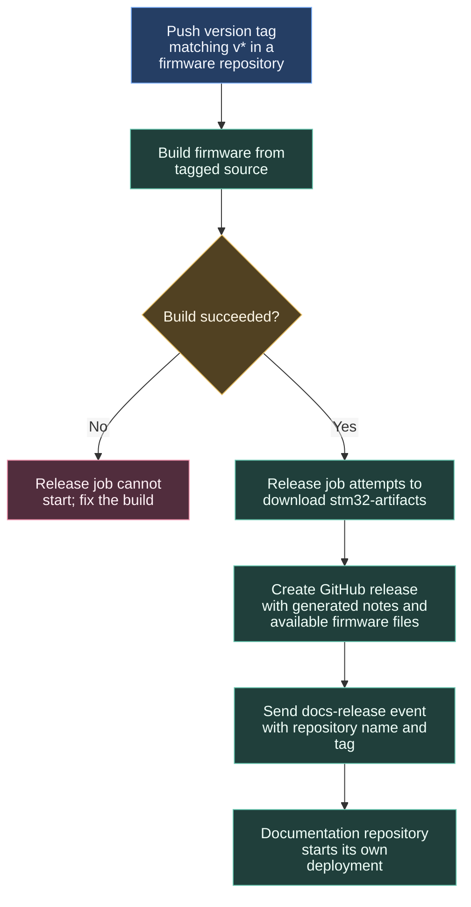

# Publishing a versioned release

A version tag identifies the source used for a release. The standard firmware release caller builds that tagged source, publishes available firmware files, and notifies the documentation site.

## Checking the release

Open the release and check the tag, notes and attached files. The shared publisher allows a release without matching firmware files. If you expected a binary, inspect the build artifact and download step even when the release exists.

Release publication and the documentation update are separate operations. Follow the notification step, then the documentation deployment run to see whether the website refreshed.

## Repositories without a firmware build

Library and application callers can use the same publisher with an empty artifact name. They get release notes and the documentation notification without requesting STM32 files. The caller determines whether a build is needed first.

The [STM32-Template caller](https://github.com/ARTTU-Software/STM32-Template/blob/main/.github/workflows/release.yml) responds to `v*` tag pushes and uses `needs: build-firmware`. See [documentation deployment](/architecture/ci/documentation-deployment) for what the notification starts.

## Workflow contract

Source: [create-release.yml](https://github.com/ARTTU-Software/.github/blob/main/.github/workflows/create-release.yml).

| Input / secret | Contract |
| --- | --- |
| `artifact_name` | String, empty by default; download is skipped when empty |
| `DOCS_DISPATCH_TOKEN` | Cross-repository authorization for the documentation dispatch |

The workflow checks out full history, optionally downloads artifacts, creates a release with generated notes, and attaches available `.bin`, `.elf`, and `.map` files. Download is `continue-on-error`, and unmatched files are accepted. The release job requests contents-write permission. The dispatch sends `docs-release` to `ARTTU-Software/documentation` with `repo` and `tag` payload fields. Check both release assets and the notification result.

[Back to CI/CD overview](/architecture/github)
