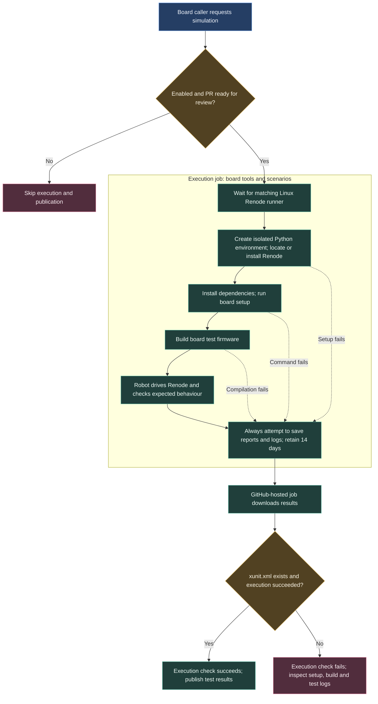
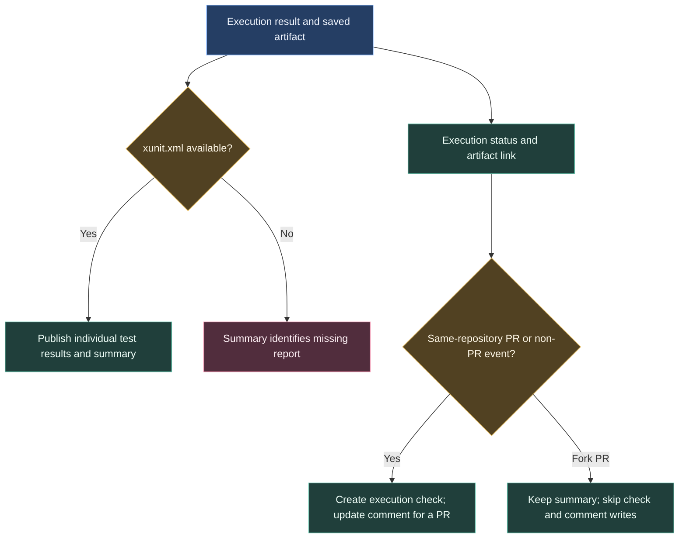

# Running firmware in Renode

Renode runs firmware in an emulated machine. Robot tests supply events and check the response, allowing us to repeat a scenario without a physical board. Each board repository supplies its model, test firmware and assertions.

Execution and publication use separate jobs. The workshop runner runs the scenarios; a GitHub-hosted runner publishes their results.

## Finding out what actually ran

Download `renode-results` from the workflow run. Robot reports and logs explain individual scenarios; the execution check says whether the job completed with an xUnit report. A missing report can mean setup or compilation failed before any test ran.

The template's default build command is `python --version`, which checks the infrastructure. A board needs its own build command and scenarios before the result says anything about that board's firmware. Physical timing and electrical behaviour still need board testing.

## Publishing the results

The publication job can explain a failed execution even when no test report was produced. This keeps a setup failure visible rather than presenting it as a passing test.

The template caller excludes fork PRs entirely. The shared publisher also restricts check and comment writes if a different caller allows a fork context.

## Board-owned simulation

Telemetry has a separate Docker procedure. It builds the image and Debug firmware, runs `renode/run_tests.sh`, converts Robot output to `junit.xml`, and saves `renode-report` for 14 days. It uses a self-hosted Linux/x64 runner and skips drafts. Check the [adoption snapshot](/architecture/github-reference#repository-adoption-snapshot) before assuming a board uses the shared implementation.

## Workflow contract

Sources: [renode-test.yml](https://github.com/ARTTU-Software/.github/blob/main/.github/workflows/renode-test.yml) and [STM32-Template caller](https://github.com/ARTTU-Software/STM32-Template/blob/main/.github/workflows/renode.yml). The caller is maintained in the template or adopting board repository, outside the tooling sync payload. The central workflow skips execution and publication for draft pull requests.

| Input | Default | Purpose |
| --- | --- | --- |
| `enabled` | `true` | False skips execution and publication |
| `runner` | `'["renode"]'` | JSON `runs-on` labels array or group/labels object |
| `python-version` | empty | Reuse installed Python, or request setup-python |
| `renode-url` | empty | Optional Linux x64 portable .NET archive over HTTPS |
| `renode-sha256` | empty | Required 64-hex SHA-256 when downloading an archive |
| `renode-path` | empty | Installed executable, otherwise PATH discovery |
| `renode-tests` | empty | Installed directory containing Renode’s `run_tests.py` |
| `arm-gdb` | empty | ARM-capable GDB path for source-debugging tests |
| `setup-command` | empty | Board dependency setup before the build |
| `build-command` | **required** | Build the board’s test ELF(s) |
| `test-command` | `python test/renode/harness/run_tests.py` | Board regression runner |
| `requirements` | `test/renode/harness/requirements.txt` | Robot/test Python dependencies |
| `jobs` | `1` | Independent suite workers; benchmark before increasing |
| `timeout-minutes` | `30` | Execution job limit |
| `artifact-name` | `renode-results` | Unique name per caller matrix variant |

Execution currently requires Linux and Bash. It creates an isolated Python environment under runner temporary storage, selects installed Renode or verifies/downloads the configured archive, installs requirements, runs setup/build/test commands, and uploads `build/renode/results/` with 14-day retention. The runner must honor `RENODE`, `RENODE_JOBS`, and `RENODE_RESULTS_DIR`; `RENODE_TESTS` and `ARM_GDB` are also exported. Existing `test/renode/requirements.txt` and `test/renode/run_tests.py` layouts have explicit compatibility fallbacks.

The archive is validated before extraction. For installed Debian Renode, the workflow can select the underlying `Renode.dll` so Robot process/port discovery uses the native .NET process. Board callers remain responsible for setup commands, model fidelity, ELF/platform compatibility, and useful assertions.

The separate `publish` job runs on Ubuntu 24.04, downloads the report artifact, and publishes `xunit.xml` when present. It adds a summary, an execution-status check, and a marked PR comment that is updated on subsequent runs. The execution check succeeds only when a report exists and the execution job succeeded. Upload/download/report absence remains visible in the summary. Fork contexts do not receive check/comment writes, and the template caller excludes fork PRs entirely.

The **STM32-Template caller** maps these repository variables:

| Variable | Caller behavior |
| --- | --- |
| `RENODE_ENABLED` | Only the string `false` opts out; unset is enabled |
| `RENODE_PATH`, `RENODE_TESTS` | Installed tool and runner-script paths |
| `RENODE_SETUP_COMMAND` | Optional setup |
| `RENODE_BUILD_COMMAND` | Defaults to `python --version` for infrastructure smoke |
| `RENODE_TEST_COMMAND` | Defaults to the harness runner |
| `RENODE_REQUIREMENTS` | Defaults to harness requirements |
| `RENODE_JOBS` | Parsed as JSON number, defaults to 1 |

That caller selects the `salita` runner group with labels `self-hosted`, `Linux`, `X86`, and `renode`, and sets `arm-gdb: /usr/bin/gdb-multiarch`. Its triggers are PR opened/synchronize/reopened/ready-for-review and manual dispatch; concurrency cancels earlier runs of the same workflow/ref. Draft PRs are skipped; marking a PR ready for review starts the workflow. A caller file or passing infrastructure smoke is insufficient evidence of board regression coverage.

[Back to CI/CD overview](/architecture/github)
