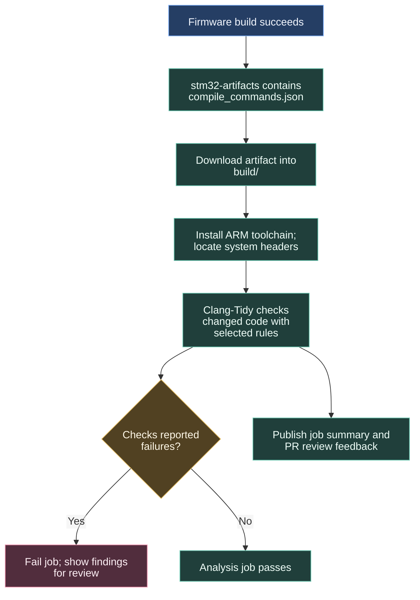

# Reviewing code with Clang-Tidy

Clang-Tidy reads source code and looks for patterns associated with bugs or unnecessary work. It uses the firmware build's compiler settings to understand the target and included headers.

## Reading a finding

Read the diagnostic alongside the changed code and its callers. Decide whether the suggested problem is real for this target, then fix the code or explain why the finding does not apply. Understand the result before changing a rule.

The job waits for the firmware build. If it cannot find the compile database, check the upstream artifact and the caller's dependency before investigating analysis rules.

## Workflow contract

The optional `artifact_name` input defaults to `stm32-artifacts`. The caller orders lint after the build with `needs`. The job downloads the artifact into `build/` and supplies ARM target and system-header arguments to Clang-Tidy.

Enabled rule families are `bugprone-*`, `clang-analyzer-*` and `performance-*`. The YAML excludes selected rules for reserved identifiers, swappable parameters, unsafe buffers, integer-to-pointer performance findings and fixed-address dereferences. Refer to that list when investigating a particular rule.

`Drivers`, `Middlewares`, `test` and `build` are ignored. `lines-changed-only: 2` limits review scope. This provides focused feedback on changes, rather than a complete analysis of the repository.

Clang-Format is disabled. Clang-Tidy reviews, summaries and PR thread updates are enabled; `checks-failed > 0` fails the job. Permissions are contents read, pull requests write and checks write.

Source: [linter.yml](https://github.com/ARTTU-Software/.github/blob/main/.github/workflows/linter.yml).

[Back to CI/CD overview](/architecture/github)
