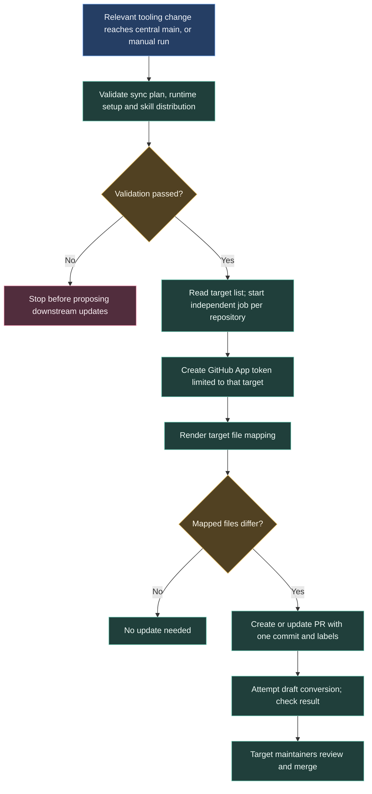

# Updating shared development tools

Some tools need files inside each project: assistant instructions, skills and local checks. Sync proposes updates through pull requests so each repository can review the change.



## What gets updated

Mappings in `.github/sync.yml` and the runtime manifest define the payload. A new central file is not distributed just because it exists. Renode callers and board test scenarios are outside this payload.

The ten destinations are CAN-Gateway, ECU, Dashboard, Telemetry, LVSOC-26, Galvanic-Isolator, common, BMS-Master, STM32-Template and utilities. The first eight target `dev`; the template and utilities target `main`.

## Authentication and failure handling

A GitHub App supplies a separate installation token for each target. The workflow requests contents and pull-request writes using `SYNC_APP_ID` and `SYNC_APP_PRIVATE_KEY`. The App needs access to the destination.

The matrix sets `fail-fast: false`: one failing destination does not cancel the others. Inspect its individual job when an update is missing. Changes use the commit prefix `chore(tooling): ` and labels `automation` and `agent-rules`. Draft conversion may fail; verify the PR state.

## Plan checks

```sh
python .agents/hooks/sync_plan.py check
python .agents/hooks/doctor.py --self-test
python -m unittest discover -s .agents/tests -p test_sync_plan.py -q
```

Passing the plan checks validates the payload. Adoption happens when the destination's update is merged.

Sources: [sync workflow](https://github.com/ARTTU-Software/.github/blob/main/.github/workflows/sync-agent-rules.yml), [target mappings](https://github.com/ARTTU-Software/.github/blob/main/.github/sync.yml).

[Back to CI/CD overview](/architecture/github)
