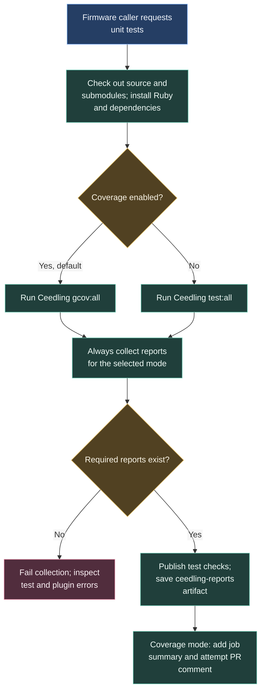

# Unit tests and coverage

Unit tests give a small piece of code known inputs and compare the answer with an expected value. Ceedling runs our C tests on the GitHub runner. Coverage reporting also records which source code the tests exercised.

## Reading the result

Start with the Ceedling execution log. A failed assertion identifies the test and the expected and actual values. If no tests ran, check dependency installation and `project.yml` before interpreting the report publisher.

Download `ceedling-reports` for the generated files. A missing JUnit report is a reporting or configuration failure. Projects must enable the appropriate report plugins and formats.

Coverage helps locate code that needs tests. Executing a line does not establish that the test checked every relevant outcome.

## Report paths and custom build directories

Collection runs even after a test failure. It searches `**/artifacts/gcov/` with coverage enabled and `**/artifacts/test/` otherwise. This supports a custom Ceedling build root, such as `out/`, without changing the workflow.

The selected directories must contain `junit_tests_report.xml`. Coverage mode also requires `gcovr/coverage.txt`. Missing required reports fail collection; a report from the other mode cannot substitute for them. Collection includes all matching directories for the selected mode.

The workflow publishes JUnit results with failures and inconclusive results treated as errors, saves the report directories, and adds coverage to the job summary. Creating or updating the coverage PR comment is attempted separately; comment failure is tolerated.

## Workflow contract

| Setting | Behaviour |
| --- | --- |
| `coverage` input | Boolean, defaults to `true`; select `false` for projects without the gcov plugin |
| Environment | Ubuntu, Ruby 3.2, Bundler caching and `gcovr` |
| With a `Gemfile` | Run `bundle exec ceedling` |
| Without a `Gemfile` | Install Ceedling directly and run `ceedling` |
| Permissions | Contents read, pull requests write, checks write |
| Saved artifact | `ceedling-reports` |

Source: [ceedling-test.yml](https://github.com/ARTTU-Software/.github/blob/main/.github/workflows/ceedling-test.yml).

[Back to CI/CD overview](/architecture/github)
