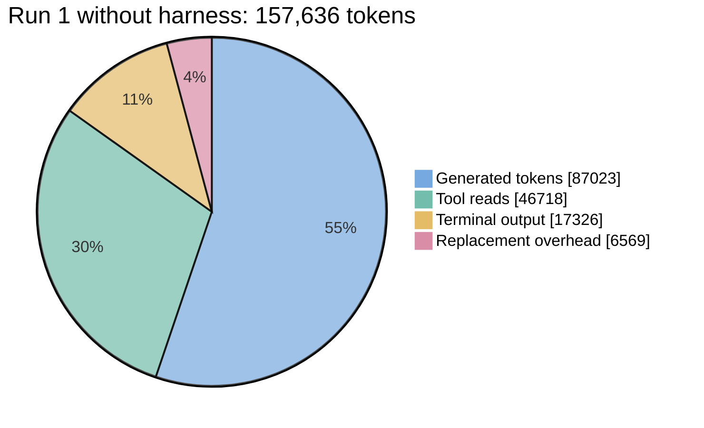
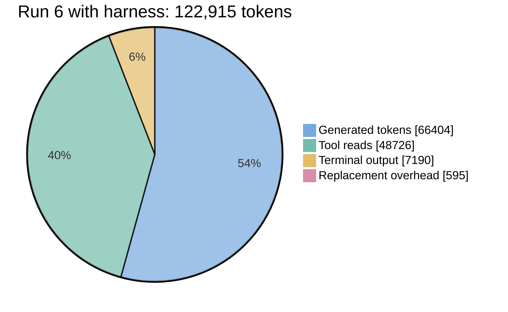

# Earlier harness benchmark results

The previous documentation compared two runs of a CAN-Gateway task: adding a sensor-sample buffer, integrating startup, writing unit tests, and building the firmware. It described Run 1 as an assistant without the harness and Run 6 as an assistant using the harness.

**These are historical figures, not measurements of the current harness.** The earlier page did not include the original run logs, full model configuration, or scoring method. The charts below preserve its reported numbers; the comparison has not been rerun for the current version.

Source: `architecture/agentic-harness.md` in the documentation repository at commit `e26264f`. The original task used an ADC ring buffer and DMA oversampling to collect and process sensor samples.

## Where the tokens went

The pie charts show the reported breakdown for each run. A token is a small piece of text processed or produced by the model. The same four categories are used in both charts so their proportions can be compared.

The reported total is 34,721 tokens lower in Run 6. Terminal output and replacement overhead account for much of the difference; the tool-read category is slightly larger. Two runs alone do not establish how much the current harness changes cost or completion time across other tasks.

## Reported results

| Item | Run 1: without harness | Run 6: with harness |
| --- | --- | --- |
| Elapsed time | 452 s | 314 s |
| Total tokens | 157,636 | 122,915 |
| Generated tokens | 87,023 | 66,404 |
| All tool-ingested tokens | 70,613 | 56,511 |
| Terminal output tokens | 17,326 | 7,190 |
| Replacement overhead tokens | 6,569 | 595 |
| Ceedling tests | No suite reported, `0 / 0` | `10 / 10` passed |
| CubeMX user-block compliance | Reported failure | Reported compliance |
| Earlier page's quality assessment | `41 / 100` | `100 / 100` |

The quality assessments are retained as reported judgments. The earlier page did not provide a scoring rubric, so they should not be read as a current or independently verified quality measure.

## What the comparison illustrates

The intended lesson was to keep investigation focused, use the repository's tests, and preserve generated-code boundaries. Those remain useful practices. Current correctness still depends on the actual source review, test results, target build, and hardware checks for the change being made.

See the [harness overview](/architecture/agentic-harness) for the current workflow and the [implementation reference](/architecture/agentic-harness-reference) for the checks that exist today.
