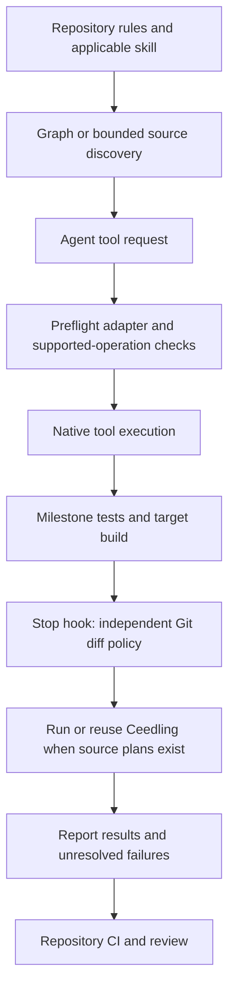

# Agent Harness Technical Reference

This page contains setup commands, supported checks, configuration files, and implementation limits. Start with the [harness overview](/architecture/agentic-harness) for an explanation of how we use it. The implementation was reviewed on 19 October 2026.

The source is `ARTTU-Software/.github/docs/harness-reference.md`. The documentation hub consumes this repository through its `repos/agent-harness` submodule. Edit the source in `.github`, then update the documentation repository's submodule commit.

## Setup and activation

Run from the repository root:

```sh
python .agents/hooks/doctor.py
```

Python 3.11 or later is needed (`doctor.py` imports `tomllib`). Git is required for diff verification and evidence caching. Node.js/npm supplies `npx` for the configured MCP servers. Firmware verification also needs the board's Ceedling dependencies and target build tools.

The doctor validates configuration shapes, adapter selection, runtime files, matching MCP definitions and, in the central repository, sync completeness. It reports executables found on PATH. It does **not** establish hook activation, workspace trust, MCP connectivity, or successful firmware tests. Check those in the actual client's hook and MCP settings.

| Client adapter | Hook configuration | MCP configuration |
| --- | --- | --- |
| Antigravity | `.agents/hooks.json` | Import the server entries from `.mcp.json` into client settings |
| Claude Code | `.claude/settings.json` | `.mcp.json` |
| Codex | `.codex/hooks.json` | `.codex/config.toml` |
| Cursor | `.cursor/hooks.json` | `.cursor/mcp.json` |

These are the adapters shipped and tested by this repository. Client acceptance and execution must be checked locally. The Antigravity hook commands are relative to `.agents`; the other hook commands locate the harness by walking up from the current working directory. Preflight timeouts are 15 seconds; stop timeouts are 300 seconds. Cursor preflight specifies `failClosed: true` and its stop hook has `loop_limit: 1`.

## Execution flow



The preflight hook reconstructs supported edits before execution. The stop hook examines the resulting working tree independently. CI can run the same policy script against an explicit comparison commit. Instructions still govern requirements the scripts cannot establish, including hardware correctness, bounded waits, ISR behavior, and the required target build.

## Repository rules and skills

`AGENTS.md` supplies the shared policy. `CLAUDE.md` and `GEMINI.md` provide client entry points. Load only the skill relevant to the task:

| Skill | Responsibility |
| --- | --- |
| `arttu-code-discovery` | Graph discovery, callers, dataflow, impact, and evidence cards |
| `arttu-cstyle` | Embedded C safety and coding conventions |
| `arttu-docs-assistant` | Verify hardware specifications, CAN definitions, and mappings before interface changes |
| `arttu-docs-writer` | System-level module documentation after firmware changes |
| `arttu-stm32-debugging` | Physical STM32 SWD, flashing, RAM/register inspection, and fault analysis |
| `renode-gdb-debug` | Emulated firmware regression, fault injection, and GDB diagnosis |

Hardware contracts must be resolved before changing interfaces. Application/domain code uses BSP, driver, or interface abstractions. Runtime allocation is forbidden; ISR work and hardware waits must remain bounded. These broader engineering requirements need source review and appropriate tests.

## Discovery and context

The configured MCP packages are `codebase-memory-mcp@0.11.0` and `markdown-docs-mcp@0.1.5`. `mcp_launcher.py` accepts only its reviewed package/version allowlist and launches `npx -y` from the repository root, including Windows `.cmd` handling. The Markdown server's TOC and section byte limits are both 8192.

For structural code questions, resolve the nearest indexed project and current generation, then use `search_graph`, `trace_path`, and `get_code_snippet`. Default to Verify evidence: exact source for material behavior, relevant caller/callee checks, and relevant pagination. Scout findings are provisional; negative or exhaustive conclusions need bounded scope verification.

Call `check_index_coverage` with every evidence path and the relevant scopes. Read reported gaps or stale source directly. A clean coverage report is a best-effort signal. Missing MCP connectivity permits targeted source fallback; record that limitation and continue work whose facts can be established locally.

Whole-file reads are permitted for cohesive files of at most 200 lines. For larger files, use graph snippets or windows of at most 100 lines. A portable fallback is:

```sh
python .agents/hooks/read_context.py path/to/source.c --start 40 --end 90
```

`context_cache.py` stores local evidence cards under `.agents/state/context`. Cards contain a scope and selected facts, relationships, unknowns, checks, and coverage. Each card is limited to 8 KiB and records HEAD, named source-file hashes, and an optional graph generation. A changed HEAD, source hash, missing file, or mismatched/unspecified recorded generation invalidates reuse. Cached conclusions still require revalidation when their scope or safety assumptions change.

## Preflight checks

`pre_tool_enforcer.py` normalizes client payloads through `hook_io.py`, rejects payloads over 2 MiB, then dispatches by tool name. `edit_plan.py` and `patch_plan.py` reconstruct complete supported mutations, including multi-edit operations, and reject missing or ambiguous context. `policy.py` evaluates the proposed before/after content.

| Check | Implemented behavior |
| --- | --- |
| Reads | Recognized file reads enforce the 200-line whole-file / 100-line window policy. Markdown section reads are delegated to the section tool. |
| Generated C/H | Files with USER CODE markers, plus recognized root `main` and STM32 interrupt/MSP files, receive generated-text checks. Existing generated bytes and marker identity/order must match after removing user-block contents. Malformed, nested, unmatched, or unclosed markers fail. Whole-file replacement or deletion of existing generated files fails. |
| Protected files | Linker scripts, startup assembly, CMSIS paths, `core_*.h`, and HAL driver paths require an exact approved path exception. |
| Allocation | Newly added recognized calls (`malloc`, `calloc`, `realloc`, `free`, `pvPortMalloc`, `vPortFree`) fail in checked C/C++ source. Comments and literals are stripped before comparison. |
| Layering | New recognized HAL calls or peripheral register expressions fail under path components named `app`, `application`, or `domain`. |
| Artifacts | Known compiled suffixes `.bin`, `.hex`, `.elf`, `.o`, and `.a` are rejected by checked writes and by diff verification when present as unignored changes. |
| Shell operations | `shell_policy.py` rejects recognized mutation/bypass patterns and unbounded read patterns. |

The generated-file check applies to nested modules too when they contain USER CODE markers. Allocation and layering checks compare recognized token counts; they do not perform full semantic analysis or discover every wrapper or register expression.

Hooks are **not a sandbox**. Opaque scripts, specialized tools, unrecognized operations, and client integration gaps can bypass preflight coverage. The code explicitly exempts Renode emulated-memory writes from repository mutation checks. The harness does not validate physical pinouts, register names, timing guarantees, or all possible source mutations.

Protected-file changes require explicit human approval under repository policy. Hook exceptions use exact absolute paths in a reviewed hook definition; the standalone verifier also accepts exact reviewer-approved paths. Do not automatically enable exceptions in CI.

## Verification and failure handling

At cohesive firmware milestones, run the full Ceedling suite (`bundle exec ceedling test:all` for Bundler repositories, otherwise `ceedling test:all`) and the board's required target build. The stop hook does not run the target build.

For the independent policy gate:

```sh
python .agents/hooks/verify_changes.py --base HEAD
```

Use the actual PR base commit for a PR comparison. The script includes tracked differences and untracked, unignored source/system files. `--tests` additionally invokes Ceedling when source/system change plans exist. `--base EMPTY` supports comparisons against an empty tree.

`stop_gate.py` resolves the Git root and runs this policy against HEAD. When plans exist, it calls `verify_tests`. Ceedling requires a root `project.yml`; missing configuration, unavailable tooling, failed tests, or concurrent verification produce failures. The runtime uses Bundler when a `Gemfile` exists and `bundle` is available; otherwise it looks for Ceedling directly.

Successful test results are reused only for the same verification identity: repository HEAD, tracked and untracked unignored file contents, initialized submodule contents, and selected build-related environment values. State and Python cache files are excluded. Verification uses an exclusive lock, a 240-second test timeout, and a second identity check after tests. Logs and cached results live under `.agents/state`; inspect `ceedling.log` with a bounded read after failure. Inspect a stale `verification.lock` before retrying.

A first stop failure asks the agent to fix the issue or report verification blocked. Repeated failures are surfaced without requesting an unlimited repair loop; the hook may then allow the turn to end. An ended turn is therefore not proof of successful verification. Required CI and human review remain necessary.

Before a commit or PR, use `detect_changes(base_branch="dev", depth=2)` when available and `dev` exists. Otherwise review a bounded Git diff and report the fallback. Firmware PRs target `dev`. The central harness repository currently uses `main`; keep work local until its publication target is resolved.

## Distribution and CI

`.github/sync.yml` defines source/destination mappings and targets. `.agents/harness-manifest.json`, `doctor.py`, and `sync_plan.py check` validate the runtime payload. The sync workflow runs on relevant pushes to central `main` and manual dispatch, builds its target matrix from the plan, and opens sync PRs through a GitHub App. It attempts to convert created PRs to drafts.

The configured destinations are `STM32-Template@main`, `utilities@main`, and `CAN-Gateway`, `ECU`, `Dashboard`, `Telemetry`, `LVSOC-26`, `Galvanic-Isolator`, `common`, and `BMS-Master` on `dev`. The App needs contents and pull-request write permissions. Charger has a skill/use case in the ecosystem but is not currently in this sync target list.

The payload copies agent entry points, skills including references/metadata, hook runtime, ignore rules, and client/MCP configurations into downstream repositories. Renode callers and board tests are repository-owned and are not distributed or overwritten by sync. Central tests, documentation, the manifest, sync planner, benchmark helper, and central CI are not part of that runtime payload. Board repositories consume copied files through sync PRs; the documentation hub separately consumes this repository as a Git submodule.

`agent-harness-check.yml` runs setup/regression checks on Ubuntu and Windows with Python 3.11, plus an independent policy comparison using the workflow/event base. A separate Ubuntu job with Python 3.12 and pinned PyYAML checks Renode workflow reporting contracts. These jobs execute centrally; downstream required checks must be configured in those repositories.

STM32-Template provides a starter Renode caller invoking the central reusable `renode-test.yml@main`; existing boards adopt and maintain their own callers. The template selects the workshop runner group; repository variables select paths, commands, requirements, and parallelism. `RENODE_ENABLED=false` opts out. Without board commands/manifest, only infrastructure smoke coverage is expected. The template caller excludes fork and draft PRs and runs when a PR becomes ready for review. The central reusable workflow also skips execution and publication for draft PRs. Renode regression and physical SWD validation remain distinct workflows.

## Maintaining the harness

After runtime or distribution changes, run in the central `.github` repository:

```sh
python .agents/hooks/doctor.py
python -m unittest discover -s .agents/tests -q
python .agents/hooks/sync_plan.py check
python .agents/hooks/verify_changes.py --base HEAD
```

`doctor.py --self-test` combines the setup check with the central regression suite. Downstream checkouts should use the doctor without `--self-test`, because those tests are central-only. Report commands actually run and distinguish static setup checks from live client activation and board verification.

When documentation changes, commit the updated page in `.github`, publish that commit through the agreed branch, then update `repos/agent-harness` in the documentation repo and run `npm run docs:build`. The hub retains its existing public route through a VitePress rewrite. Deployment keeps this submodule at the recorded commit; the other product submodules retain their release-tag policy.

Historical performance percentages and quality scores from the previous page are omitted: they are not reproducible evidence for the current harness. `benchmark_context.py` measures instruction entry-point bytes against a Git base; it does not measure paid/model tokens or firmware correctness.
